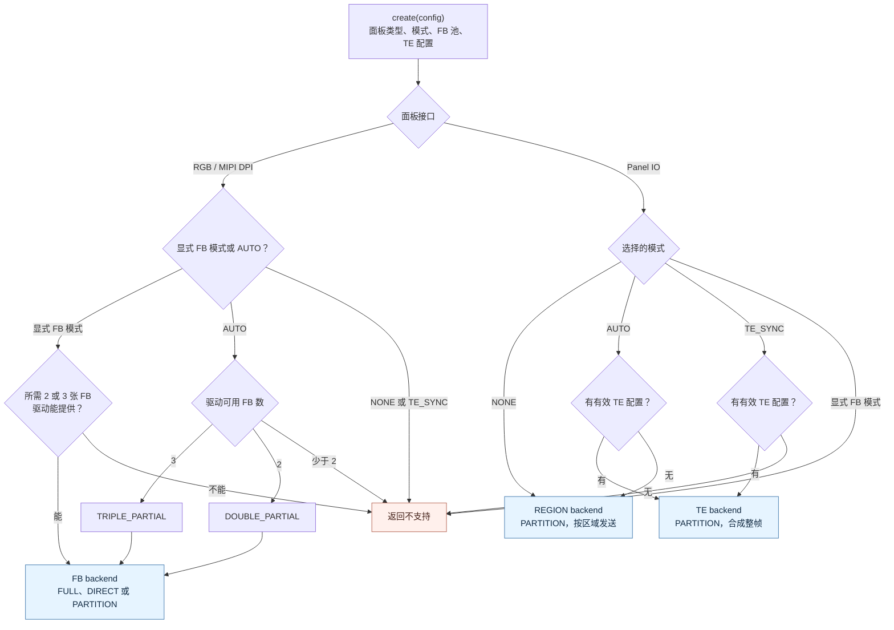
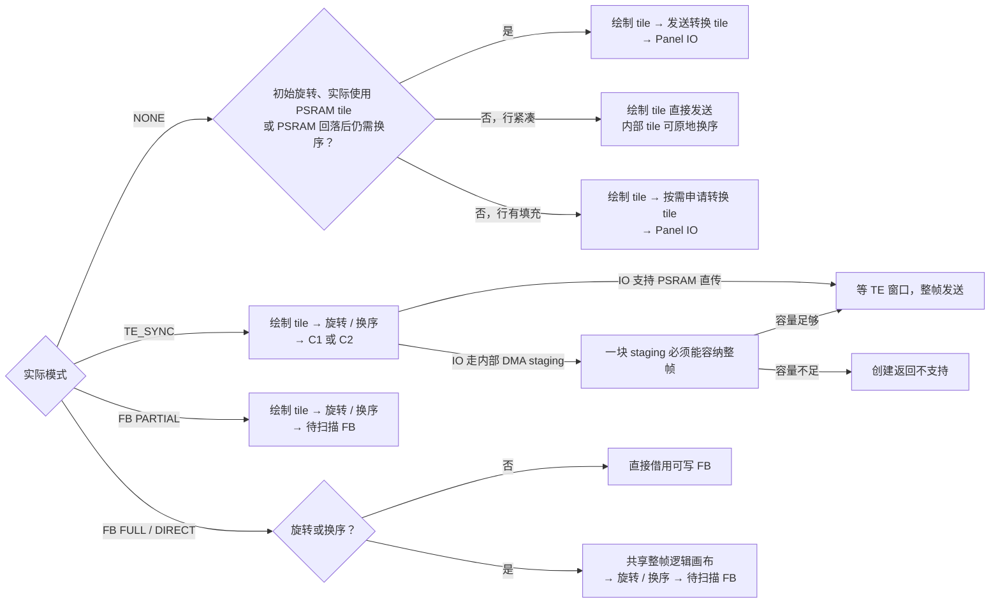
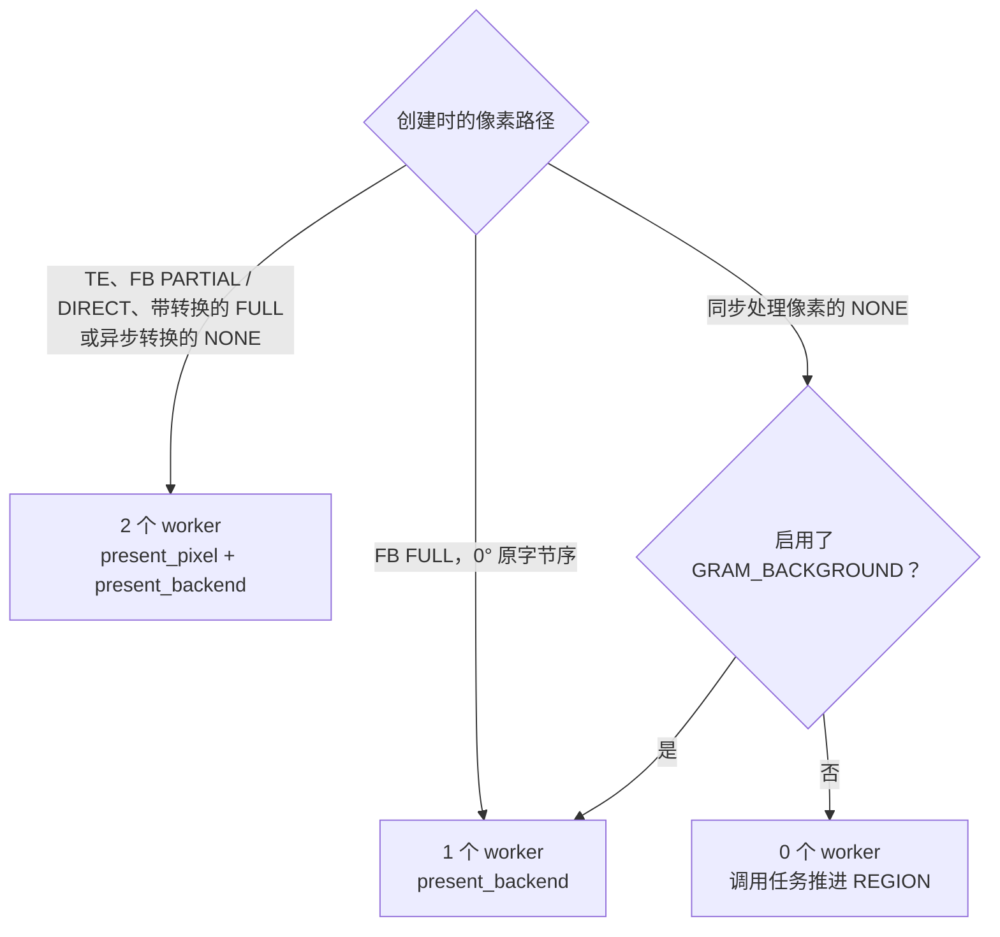

# ESP Display Present

`esp_display_present` 提供稳定的 `esp_display_presenter_*` 应用接口、平台资源装配和唯一显示引擎；`esp_lv_present` 将 LVGL 接入同一引擎。应用继续持有 panel、IO 和总线资源。

[一键初始化](#一键初始化) · [模式与缓冲组合](#模式与缓冲组合) · [创建时资源](#创建时资源) · [运行时旋转](#运行时旋转) · [公开配置与接口](#公开配置与接口)

公开应用头位于 `include`；`src` 内头文件均为内部实现，不作为应用 API 导出。当前版本不再公开旧几何头和其中的坐标／尺寸类型；依赖这些接口的应用需单独迁移，不能将其视为完全源码兼容。

本地依赖只需 `esp_display_present`，LVGL 场景再加入 `esp_lv_present`，不再需要 V2 组件。源码合并不代表已发布 Registry 包或确认全部外部兼容。开发和验证入口见 [迁移状态](MIGRATION_STATUS.md)，历史设计见 [交接设计 (archive)](dev/ARCHIVE.md)。

## 一键初始化

面板由应用或 BSP 初始化。描述一次物理分辨率、接口和实际像素格式，之后用模式打开 Present。初始旋转配置在 `hw.rotation`，旋转 90° 或 270° 时接口自动交换上层的逻辑宽高。

```c
const esp_display_presenter_panel_config_t lcd = {
    .width = 480, .height = 480,
    .hw = {
        .panel = panel,
        .panel_type = ESP_DISPLAY_PRESENT_PANEL_RGB,
        .input_pixel_format = ESP_DISPLAY_PRESENT_PIXEL_FORMAT_RGB565,
    },
};
esp_display_presenter_t *presenter;
esp_err_t err = esp_display_presenter_open(&lcd, ESP_DISPLAY_PRESENT_MODE_AUTO, &presenter);
```

RGB/MIPI 在初始化面板时配置 FB 池，Panel IO 提供 `hw.io`，接有 TE 时填写 `hw.te_enabled` 和 `hw.te_sync`。需要控制 tile 行数、T1/T2、PSRAM 偏好或 TE 的 C1/C2 时，调用 `open_ex(&lcd, mode, &drawbuf, &presenter)`。例如 T2C2 设置 `drawbuf.buffers = 2` 和 `drawbuf.te_compose_buffers = 2`。超时、脏区上限及显式 FB 地址由高级 `create()` 配置。成功后用 `get_effective_config()` 查询实际模式和缓冲池。

## 模式与缓冲组合

**FB** 是驱动创建的整帧扫描缓冲，**T** 是绘制 tile 数，**C** 是 TE 传输前的整帧合成缓冲数。选择模式后，还要根据旋转、字节序和内存位置计算转换资源。



| 公开模式 | 面板接口 | 上层绘制方式 | 主缓冲池组合 |
|---|---|---|---|
| `NONE` | Panel IO | 按 tile 绘制，逐区域发到面板 | T1、T2 |
| `TE_SYNC` | 有有效 TE 的 Panel IO | 按 tile 绘制，合成整帧后等 TE 窗口发送 | T1C1、T2C1、T1C2、T2C2 |
| `DOUBLE_FULL` | RGB / MIPI DPI | 每次绘制整帧 | 2 FB |
| `TRIPLE_FULL` | RGB / MIPI DPI | 每次绘制整帧 | 3 FB |
| `DOUBLE_DIRECT` | RGB / MIPI DPI | 在全尺寸缓冲上绘制脏区 | 2 FB |
| `DOUBLE_PARTIAL` | RGB / MIPI DPI | 按 tile 绘制并组装到待扫描 FB | 2 FB + T1、2 FB + T2 |
| `TRIPLE_PARTIAL` | RGB / MIPI DPI | 按 tile 绘制并组装到待扫描 FB | 3 FB + T1、3 FB + T2 |
| `AUTO` | RGB / MIPI DPI | 根据驱动 FB 池选 PARTIAL | 3 FB 选 `TRIPLE_PARTIAL`，2 FB 选 `DOUBLE_PARTIAL`，少于 2 FB 返回不支持 |
| `AUTO` | Panel IO | 根据 TE 配置选 PARTITION 路径 | 有效 TE 配置选 `TE_SYNC`，其余选 `NONE` |

RGB/MIPI 准入还要校验格式、物理尺寸和旧 FB 的扫描退休能力。驱动适配层负责确定 RGB bounce 或切链协议。MIPI DPI 路径需要 SDK 提供相应的帧完成和 VSYNC 回调。Panel IO 的板测记录覆盖 SPI/QSPI。`TE_SYNC` 的公开头文件也列出了 I80。[模式与 LCD 适配](docs/MODE_ARCHITECTURE.md#公开模式实际走向) · [兼容范围](COMPATIBILITY.md) · [板测记录](dev/VALIDATION.md)

S31 无 bounce RGB 在构建时核验过驱动和 cache 实现，且 BSP 确认没有显式重启、SDK 未开启 VSYNC 周期重启时，由 RGB 驱动执行一次整帧 cache 写回。其他扫描路径由 Present 写回。[扫描适配器](src/platform/lcd/present_lcd_fb_scanout.c)

### TE 四种组合

| 组合 | `target.drawbuf.buffers` | `target.drawbuf.te_compose_buffers` | 可重叠的工作 |
|---|---:|---:|---|
| T1C1 | 1 | 1 | 单 tile、单 compose |
| T2C1 | 2 | 1 | 绘制下一 tile 与处理上一 tile |
| T1C2 | 1 | 2 | 合成下一帧与发送上一帧 |
| T2C2 | 2 | 2 | tile 处理和整帧合成都可重叠 |

`buffers = 0` 自动选 T1/T2，允许在自动选出的 T2 分配失败时尝试 T1。`te_compose_buffers = 0` 等同 C1。C2 增加一块合成缓冲，Panel IO 仍逐帧发送。实际发帧取决于面板 TE 窗口和总线预算。[公开缓冲配置](include/esp_display_present_config.h) · [TE 时序](docs/TE_TIMING.md) · [QSPI 跑分矩阵](dev/tools/run.py)

## 创建时资源



| 模式 | 创建条件 | 实际像素缓冲 | 默认 worker 数 |
|---|---|---|---:|
| `NONE` | `0°`、实际使用内部 tile、原字节序。包含 PSRAM 偏好回落 | T1/T2。紧凑 stride 直接发送，带行填充时按需分配转换 tile | 0 |
| `NONE` | `0°`、直接选择内部 tile、RGB565 换序 | T1/T2。紧凑 stride 可原地换序，带行填充时按需分配转换 tile | 0 |
| `NONE` | 初始 `90° / 180° / 270°`、实际使用 PSRAM tile，或 PSRAM 偏好回落到内部 tile 后仍需换序 | T1/T2 + 同数量内部 DMA 发送转换 tile | 2 |
| `TE_SYNC` | T1/T2 × C1/C2，可选旋转和 RGB565 换序 | T + C。旋转或换序直接写入 compose。IO 无 PSRAM 直传能力时按当前 staging 路径校验并增加 1 块内部 DMA staging，容量须覆盖整帧 | 2 |
| `DOUBLE_PARTIAL` / `TRIPLE_PARTIAL` | 原方向、旋转、RGB565 换序或两者叠加 | 2/3 FB + T1/T2。转换直接写入待扫描 FB | 2 |
| `DOUBLE_FULL` / `TRIPLE_FULL` | `0°`、原字节序 | 2/3 FB，直接借用可写 FB | 1 |
| `DOUBLE_DIRECT` | `0°`、原字节序 | 2 FB，直接借用可写 FB，跨帧可能修补像素 | 2 |
| `DOUBLE_FULL` / `TRIPLE_FULL` / `DOUBLE_DIRECT` | 初始旋转非 `0°`，或 RGB565 换序 | 2/3 FB + 1 块共享整帧逻辑画布。旋转和换序叠加时仍共用一块 | 2 |
| `AUTO` | 解析出实际模式后 | 按该模式和转换条件计算 | 同实际模式 |

图中的 staging 是将源像素搬到内部 DMA 内存的发送缓冲。当前 TE staging 按约 32 KiB 的整行容量计算，整帧放不下时返回 `ESP_ERR_NOT_SUPPORTED`。逻辑画布和 TE compose 在规划时优先选可容纳的 PSRAM，否则用内部 DMA 内存。REGION 的懒分配缓冲，以及 FB/TE 的覆盖位图，可能在创建之后才出现。预算和实际驻留应分别计算。[资源装配](src/resources/present_resources.c) · [资源规划](src/config/present_plan.h) · [REGION 提交](src/backend/present_backend_region.c)

异步拷贝按 SDK 能力和请求条件选择执行器。非 `0°` 旋转优先尝试 PPA，`0°` 优先尝试 DMA2D。请求不满足硬件准入条件时可在启动前走 CPU。PSRAM XIP 由固件的 SDK 配置控制。[执行器选择](src/resources/present_resources.c) · [SDK 能力](COMPATIBILITY.md)

### Present 后台任务



每个 worker 默认 **4 KiB 栈**。`CONFIG_ESP_DISPLAY_PRESENT_GRAM_BACKGROUND` 默认关闭。开启后，内部 tile 的普通 GRAM 路径用 backend worker 在引擎 gate 外提交，优先级由 `CONFIG_ESP_DISPLAY_PRESENT_GRAM_BACKGROUND_PRIORITY` 设置，默认 7。TE 另用 GPIO 中断，在支持的 SDK 上用系统 `esp_timer` 任务处理定时器回调。RGB 驱动的 bounce buffer、LVGL 自己的绘制或备用缓冲、应用任务均单独计入整机 RAM。[GRAM 后台配置](Kconfig) · [GRAM 首版条件与实测（归档）](dev/ARCHIVE.md) · [TE 定时器](src/platform/te/present_te_timer.c)

**480×480 RGB565 的额外成本示例。** FULL/DIRECT 新增一块逻辑画布为 **450 KiB**。TE 从 C1 到 C2 同样多 **450 KiB**。两块 50 行绘制 tile 的 `NONE` 从 `0°` 普通路径改为创建时启用旋转，多两块发送转换 tile（约 **94 KiB**）和 **8 KiB** worker 栈。以上是对应项目的增量，整机预算还需纳入元数据、对齐和驱动或渲染器资源。

## 运行时旋转

先暂停生产者并 `quiesce()`，再调用 `set_rotation()`。物理屏幕保持原尺寸。切换成功后重新查询逻辑宽高、stride 和 tile 容量。

| 已创建的路径 | 切换结果 |
|---|---|
| `NONE`，`0°` 原字节序切到非 `0°` | 先分配各发送槽缺少的转换 tile，再更新布局。沿用创建时的任务配置。回到 `0°` 时已分配的转换 tile 仍保留 |
| `NONE`，创建时使用原地换序 | 切到非 `0°` 返回 `ESP_ERR_NOT_SUPPORTED` |
| FB FULL / DIRECT | 按需增加或释放共享逻辑画布，保留物理 FB 池。仍需换序时，回到 `0°` 也保留画布 |
| FB PARTIAL / TE | 复用 FB、tile 或 compose 池。跨轴切换后，按原 tile 字节容量和新逻辑行宽重新计算可绘制行数 |

旋转要新增的像素缓冲在布局生效前分配。原生 FULL 首次旋转时同时创建像素 worker，回到 `0°` 后保留该 worker 供下次旋转复用，关闭时回收。分配失败时保留原布局。[REGION 旋转](src/backend/present_backend_region.c) · [FB 旋转](src/backend/present_backend_fb.c) · [TE 旋转](src/backend/present_backend_te.c)

## 公开配置与接口

RGB/MIPI 的 FB 数量在创建面板时确定。可以先用 `esp_display_present_get_required_frame_buffer_count()` 查数量，再创建面板并调用 `esp_display_presenter_create()`。Panel IO 的 FB 数量查询返回 0。现有配置为 `esp_display_presenter_config_t`，`mode = 0` 表示 `NONE`，自动选择须显式填 `ESP_DISPLAY_PRESENT_MODE_AUTO`。

| 配置字段 | 作用 |
|---|---|
| `width`、`height`、`pixel_format` | 初始逻辑宽高与绘制格式。跨轴创建时逻辑宽高和物理宽高互换。支持 RGB565、RGB888，绘制格式与面板输入格式匹配 |
| `target.hw.panel`、`io`、`panel_type`、`input_pixel_format` | 借用已初始化的面板和 IO。RGB/MIPI 指定类型。Panel IO 提供 `io`，可用 `PANEL_AUTO` 解析 |
| `target.hw.rotation`、`swap_bytes` | 初始 `0° / 90° / 180° / 270°`，以及 RGB565 传输字节序。两项会影响资源路径 |
| `target.hw.te_enabled`、`te_sync` | TE 开关、GPIO、总线频率和数据线数。GPIO 0 有效，须同时设置 `te_enabled`。总线参数用于首帧预算，运行时使用测量结果 |
| `target.hw.spi_psram_dma_direct` | 驱动查询不可用时，声明 SPI IO 实际具备的 PSRAM DMA 直传能力 |
| `target.fb.mode`、`frame_buffer_count`、`frame_buffers` | 模式和可选的驱动 FB 列表。数量为 0 时组件查询驱动，显式给出的地址需与驱动一致 |
| `target.drawbuf.lines`、`buffers`、`in_psram`、`te_compose_buffers` | tile 高度、T1/T2、绘制池 PSRAM 偏好和 C1/C2。行数为 0 时按约 32 KiB 的 tile 目标计算 |
| `max_damage_areas`、`transfer_timeout_ms`、`pipeline_acquire_timeout_ms` | 脏区容量、传输完成和获取空闲缓冲的超时。填 `0` 时，默认最多 32 个脏区，两个超时各为 `1000 ms` |

下表除 FB 数量查询外，函数均省略 `esp_display_presenter_` 前缀。

| 用途 | 公开函数 | 适用范围 |
|---|---|---|
| 建屏前规划 | `esp_display_present_get_required_frame_buffer_count()` | 全模式，报告所需面板 FB 数 |
| 生命周期 | `open()`、`open_ex()`、`create()`、`quiesce()`、`stop()`、`delete()` | 全模式 |
| 生产者交接 | `release_producer()`、`rebind_producer()` | 全模式，帧间执行 |
| 旋转和坐标 | `set_rotation()`、`map_point()` | 全模式，旋转按实际路径校验 |
| 能力与布局 | `get_caps()`、`get_effective_config()`、`get_buffer_alignment()` | 全模式 |
| 查看 tile 池 | `get_drawbuf()` | PARTITION。取得有效 lease 后才可写入 |
| 开帧和绘制 | `begin_next_frame()`、`acquire_buffer()`、`submit_buffer()`、`cancel_frame()` | 全模式。lease 里的 `resolve_rows` 可以查询给定 stride 下的行数 |
| 提交与完成 | `commit_frame()`、`commit_frame_with_receipt()`、`get_frame_status()`、`cancel_frame_tracking()` | 普通提交全模式可用。`track_display=true` 要求 RGB/MIPI 的硬件 VSYNC 与扫描交接能力 |
| 状态和故障 | `get_state()`、`get_fault_reason()`、`get_fault_error()` | 全模式 |
| 性能统计 | `reset_metrics()`、`get_metrics()` | P99 和缓冲等待全模式可用。扫描供帧统计要求 VSYNC 反馈 |

实际模式、tile/图像池数量、内存域、stride 和降级原因用 `get_effective_config()` 查询。转换 tile、逻辑画布、staging 和 worker 的分项资源预算见上表，当前查询结构未单独返回这些项目。LVGL 的 `esp_lv_present_start()`、`esp_lv_present_stop()`、`esp_lv_present_get_frame_count()` 由绑定组件提供，GSP adapter 使用这里的公开 Presenter 接口。[Present 公开头文件](include/esp_display_present.h) · [LVGL 绑定](../esp_lv_present/include/esp_lv_present.h)

## 绑定与验证说明

LVGL FULL 和原生 0° DIRECT 先取得可写租约再绑定像素，提交／取消前撤销引用，不再分配全屏占位画布；旋转 DIRECT 的实际绘图画布、PARTIAL 的 tile 兜底保留。不要在 LVGL 绑定尚存活时停止或删除 presenter。

`CONFIG_ESP_DISPLAY_PRESENT_FB_IRAM` 及整组对象链接映射已移除；显式 ISR/pixel 的 IRAM_ATTR 保留。当前性能网页及各轮配置、SRAM 口径见[测试入口](dev/README.md)，2026-11-11 的生命周期变更单独验证，不将旧成绩标成新版本。串口完成及交接检查不能单独证明光学无撕裂。

2026-11-06 的架构检查修复了公开接口运行时跨轴旋转的尺寸冲突。panel 物理尺寸固定，由 backend 更新逻辑宽高，旋转后需重新查询 caps。Host 覆盖 RGB、DSI、GRAM 的创建回滚和旋转。S3 Function EV 和 S31 Korvo 还验证了全部 RGB 模式的四种初始角度和运行时半圈旋转。[架构检查存档](dev/ARCHIVE.md) · [上板像素验证](dev/VALIDATION.md#one-call-setup-and-rgb-board-verification)

各接口的 LVGL 帧率、缓冲等待、Host 测试项和上板覆盖分别记录。S31 GRAM 缺少旋转目标存储时仍可能拒绝运行时旋转。[验证记录](dev/VALIDATION.md) · [组件状态](MIGRATION_STATUS.md) · [TE 时序](docs/TE_TIMING.md)

测试工程、板级配置、LVGL benchmark 与 adapter 对比统一入口：[dev/README.md](dev/README.md)。
