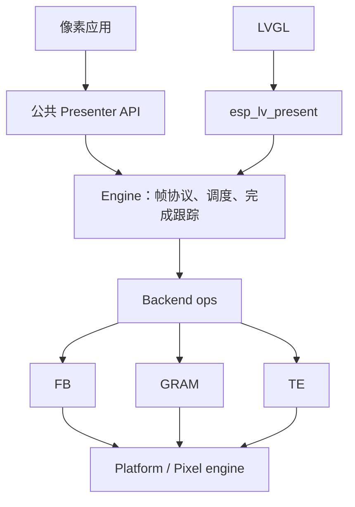
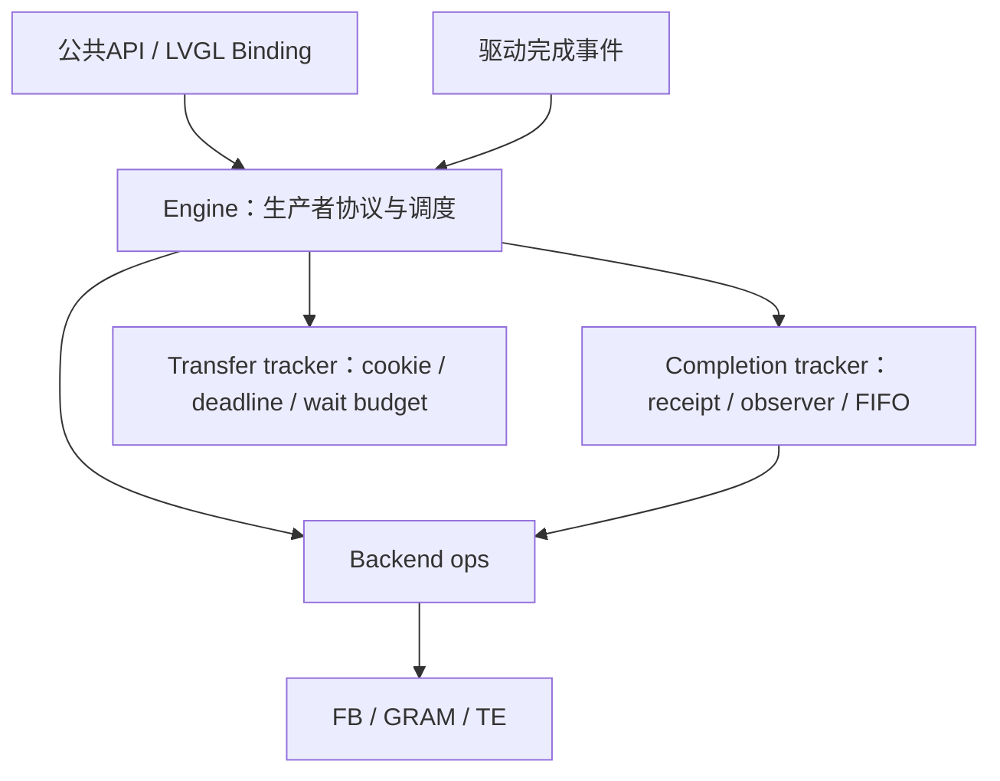
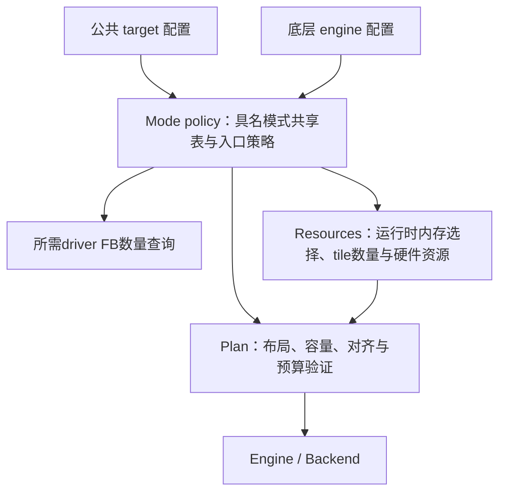
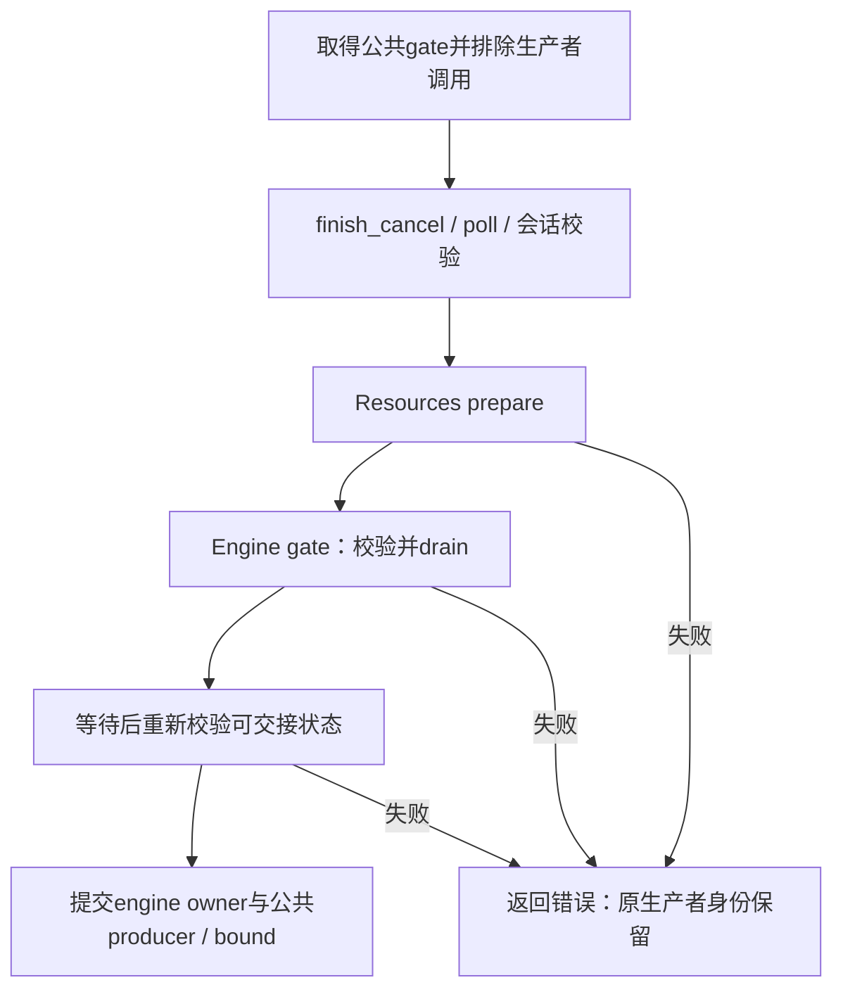

# present 架构收敛 · 2026-11-06

## 第一批：backend 推进入口收口

本批保持公共应用头文件、状态机、锁范围、缓冲数量、事件语义及资源释放条件不变。先通过小范围接口调整建立后续 engine 拆分的边界。

### 已实施

- `present_backend_ops_t.service`：所有 backend 都通过同一推进接口调用。engine 在原位置先检查传输期限，再调用 service，保持调用顺序与 gate 范围。
- `create_scheduled`：可选的创建入口，传入原 background_service 策略。TE 直接使用原 te_create_common；GRAM/FB 仍使用原 create。直接调用 TE create 时仍保留原默认自主定时器策略。
- TE task 事件经当前 ops.on_event 转发，原 TE 类型检查和通知顺序保留；ISR 入口仍使用原缓存的 event_isr 函数指针。
- 三个具体 service 函数改为 backend 文件内 static；删除全局声明。七个现有测试文件改走 ops.service，继续验证同一套传输、旋转、补全和提前回调行为。
- 删除仅透传 te_create_common 的全局 scheduled-create 包装函数。

### 本批仍保留

Engine 创建时的内置 backend 选择、GRAM 后台 sender 特殊约束，以及 TE 专用通知 API 的类型检查仍保留。它们不因 service 抽象而自动消失。

Engine 内部职责尚未拆成多个源文件。公共层/engine 的状态归属、模式解析、executor 重复校验也未在本批修改；避免同时改变状态语义和模块结构。

### 后续顺序

1. 将 engine 的完成跟踪和传输期限代码划清内部接口，再逐块迁移文件；保留 gate/control 锁及 ISR 入口约束。
2. 为现有配置保存合同、内存规划和缓冲数量对照，再统一 resolved plan 的生成路径。
3. 对公共层与 engine 的状态逐字段列出维护者、派生关系和锁，再决定哪些副本可移除。

验证记录见 [第一批证据](evidence/backend-ops-refactor-20261106/README.md)。

## 第二批：完成记录与超时时间戳模块

已将相关数据聚合到两个私有tracker，并迁移其记录算法。Engine从约1416行降至1282行，保留生产者协议、worker调度、锁及事件派发。目标是明确职责，不以代码总行数降低作为验收。

Completion沿用gate；Transfer借用control；backend调用与通知继续留在control锁外。模块没有共享完整engine结构体，也不拥有硬件像素。

验证：Host42/42、三芯片编译、S3 ELF的IRAM放置检查通过。详见[第二批证据](evidence/engine-tracking-refactor-20261106/README.md)。下一步是统一配置解析；公共层与engine状态归属收敛仍单独处理。

## 第三批：模式解析规则收口

新增私有 `present_mode` 模块。公共查询/资源规划通过 target 入口解析；底层 plan/engine 通过显式 defaults 策略解析。具名FB模式的合同与帧缓冲数量共用一张表，旧模式解析函数及分散的AUTO默认选择迁入本模块。

公共FB NONE仍是DIRECT持久画布，底层NONE仍是PARTITION。公共/legacy AUTO与current AUTO的不同默认来源明确保留；TE GPIO能力不会替代底层的真实timing条件。

Resources保留运行时堆查询、tile默认数量及硬件能力获取；Plan保留布局与预算验证。独立创建入口仍做防御性重验，复用同一模式规则，不因本次收口信任外部可修改的plan。

新增模式策略回归后Host43/43通过。改动前后的62,208组配置快照逐字节一致，三芯片完整编译通过。详见[第三批证据](evidence/mode-policy-refactor-20261106/README.md)。下一步检查公共层与engine的状态归属。

## 第四批：状态归属审计与租约描述收敛

完成[逐字段状态归属审计](STATE_OWNERSHIP_20261106.md)。多数相似字段分别承担公共撤销/观察语义与backend排空/资源所有权，不直接合并。本批将公共层完整lease描述缩为公开ID、原生ID、像素指针的身份映射，engine保管完整布局与容量。

新增身份桥接回归，覆盖地址复用、原生token高位、错误指针、错误优先级、异任务调用与取消后失效。Host44/44通过；旧版facade对象替换对照也通过同一集成测试。详见[第四批证据](evidence/lease-state-refactor-20261106/README.md)。下一步检查生产者交接事务及失败回滚。

## 第五批：交接失败时保持原生产者

跨线程回归确认bind原先过早切换engine owner，prepare/drain失败后会留下两层身份不一致。现在将owner写入推迟到排空成功之后，与公共会话更新形成最后提交段，无需增加旧owner副本或失败回滚标志。

不改变扫描回调、缓冲退休条件、成功unbind后的身份语义或公共API。Host44/44与三芯片编译验证见[第五批证据](evidence/producer-handoff-20261106/README.md)。

## 第六批：私有源码按职责归目录

将26个平铺文件迁入core、config、resources、backend、pixel、platform，保留文件基名和函数名。私有include显式携带模块路径；esp_lv_present与维护测试同步更新，不扩展模块搜索目录。

新增src/sources.cmake，统一IDF和Host源码清单，Host独立executor插件测试也复用pixel/OS组。逐文件核对52个生产源码/头文件仅include有变化，25个生产C文件的编译集合与基线完全一致。详见[目录规则](SOURCE_LAYOUT.md)及[第六批证据](evidence/source-layout-20261106/README.md)。

本批仅物理归类，尚未拆分present_presenter.h或解除memory/mode/plan对engine类型的依赖。

## 第七批：配置、生产者、控制和会话声明分离

将原present_presenter.h拆为engine_config、engine_types、engine、producer、control、session六个头文件。memory预算仅前置声明配置结构，mode/plan只依赖所需配置和类型，completion_tracker与output_caps也去掉多余的engine/backend头依赖。生产C文件仅增加或调整include，43个原函数声明完整保留。

Host新增独立C/C++头文件及依赖边界检查后45/45通过；Host/Xtensa/RISC-V各45项布局/枚举值对照一致。详见[接口职责](SOURCE_LAYOUT.md)及[第七批证据](evidence/header-contracts-20261106/README.md)。运行时owner检查、交接提交点、扫描和缓冲释放机制不变；backend配置与操作接口仍共用原backend头，未宣称所有层级已经解耦。

## 第八批：Backend配置与操作表独立

将原backend头分为协议类型、完整配置、操作表三部分。config与dispatch分别只依赖协议类型，不互相引入；只有构造/读取配置的实现显式引用完整配置，平台适配、帧状态、control/producer与transfer tracker不再依赖backend操作表。completion tracker保留其真实的ops依赖。

原三组声明逐字保留；生产C文件仅include变化。Host45/45通过，头文件独立C/C++和依赖边界检查扩展到17个入口。Host/Xtensa/RISC-V上16种类型、各147项尺寸/对齐/字段偏移/枚举值对照一致。验证范围见[第八批证据](evidence/backend-contracts-20261106/README.md)，当前依赖图见[SOURCE_LAYOUT.md](SOURCE_LAYOUT.md)。

## 第九批：Pixel职责拆分与运行上下文字段分组

基础像素类型、无状态运算与ticket/worker生命周期独立；backend类型与executor接口不再带出pixel engine API。原CPU算法、几何和状态转换经字段路径/函数名归一化后与基线一致，既有12个函数声明和外部描述符类型布局保留。

opaque pixel engine采用sync、lifecycle、notification、executor、worker五组内嵌字段，worker内继续归组priority。共同锁域不变，count/records尾随存储保留。分组不代表新增对象所有权或任务，也不批量修改配置接口。

Host增加独立无OS像素运算链接测试后46/46通过，头文件边界检查扩展至22个入口。新ops模块同步更新共享源码清单与IRAM映射。详见[第九批证据](evidence/pixel-structure-20261106/README.md)和[结构体分组规则](SOURCE_LAYOUT.md)。

## 第九批后的硬件回归

以第一批前的e9ef0a64a为基线，对d5b4d865a完成S3 RGB / P4 DSI同配置前后对照。112/112像素组合通过，覆盖七模式、四个启动角度与每组合运行时180°旋转；16组LVGL综合benchmark完成。S3四组平均FPS一致，P4三组一致、NONE 0°为27→26，单次结果不作显著性判断。用户反馈两屏正常；两板原16MiB固件均已恢复并独立整片校验。详见[硬件证据](evidence/refactor-hardware-ab-20261106/README.md)。本轮未覆盖TE/GRAM和长时间耐久测试。
