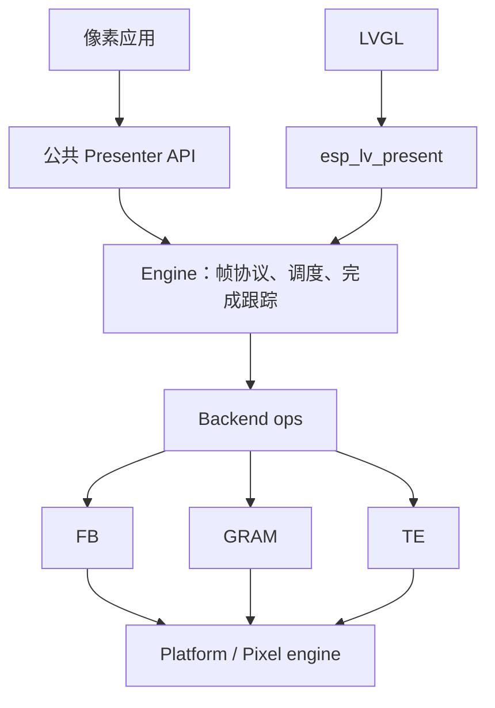
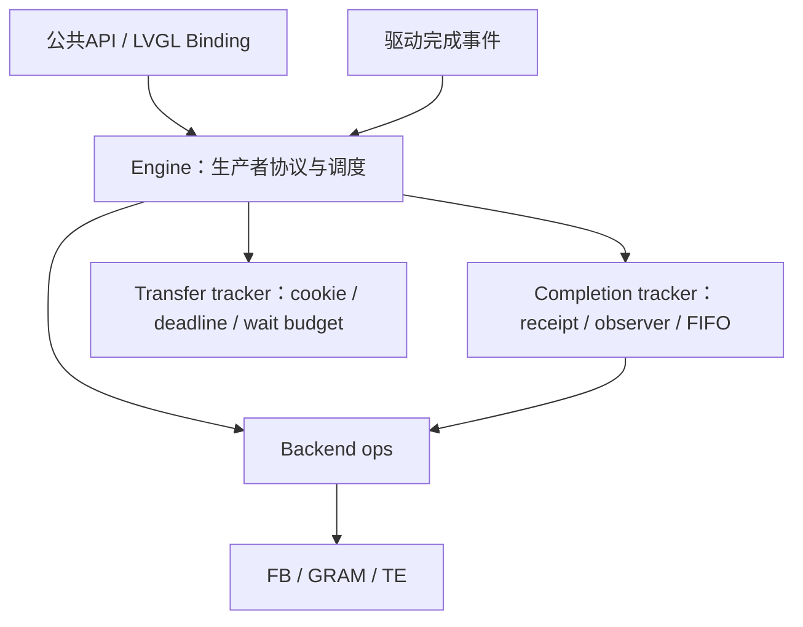
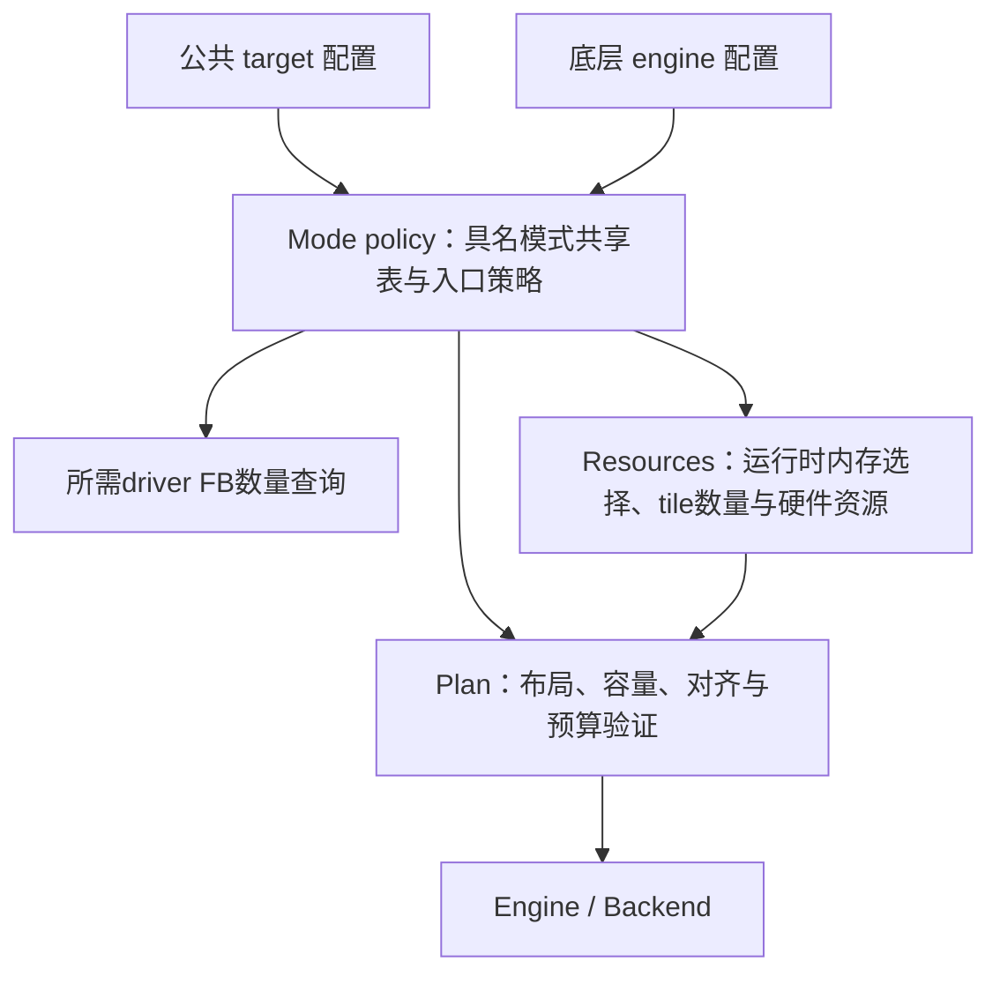

# present 架构收敛 · 2026-11-06

## 第一批：backend 推进入口收口

本批保持公共应用头文件、状态机、锁范围、缓冲数量、事件语义及资源释放条件不变。先通过小范围接口调整建立后续 engine 拆分的边界。

### 已实施

- `present_backend_ops_t.service`：所有 backend 都通过同一推进接口调用。engine 在原位置先检查传输期限，再调用 service，保持调用顺序与 gate 范围。
- `create_scheduled`：可选的创建入口，传入原 background_service 策略。TE 直接使用原 te_create_common；GRAM/FB 仍使用原 create。直接调用 TE create 时仍保留原默认自主定时器策略。
- TE task 事件经当前 ops.on_event 转发，原 TE 类型检查和通知顺序保留；ISR 入口仍使用原缓存的 event_isr 函数指针。
- 三个具体 service 函数改为 backend 文件内 static；删除全局声明。七个现有测试文件改走 ops.service，继续验证同一套传输、旋转、补全和提前回调行为。
- 删除仅透传 te_create_common 的全局 scheduled-create 包装函数。

### 本批仍保留

Engine 创建时的内置 backend 选择、GRAM 后台 sender 特殊约束，以及 TE 专用通知 API 的类型检查仍保留。它们不因 service 抽象而自动消失。

Engine 内部职责尚未拆成多个源文件。公共层/engine 的状态归属、模式解析、executor 重复校验也未在本批修改；避免同时改变状态语义和模块结构。

### 后续顺序

1. 将 engine 的完成跟踪和传输期限代码划清内部接口，再逐块迁移文件；保留 gate/control 锁及 ISR 入口约束。
2. 为现有配置保存合同、内存规划和缓冲数量对照，再统一 resolved plan 的生成路径。
3. 对公共层与 engine 的状态逐字段列出维护者、派生关系和锁，再决定哪些副本可移除。

验证记录见 [第一批证据](evidence/backend-ops-refactor-20261106/README.md)。

## 第二批：完成记录与超时时间戳模块

已将相关数据聚合到两个私有tracker，并迁移其记录算法。Engine从约1416行降至1282行，保留生产者协议、worker调度、锁及事件派发。目标是明确职责，不以代码总行数降低作为验收。

Completion沿用gate；Transfer借用control；backend调用与通知继续留在control锁外。模块没有共享完整engine结构体，也不拥有硬件像素。

验证：Host42/42、三芯片编译、S3 ELF的IRAM放置检查通过。详见[第二批证据](evidence/engine-tracking-refactor-20261106/README.md)。下一步是统一配置解析；公共层与engine状态归属收敛仍单独处理。

## 第三批：模式解析规则收口

新增私有 `present_mode` 模块。公共查询/资源规划通过 target 入口解析；底层 plan/engine 通过显式 defaults 策略解析。具名FB模式的合同与帧缓冲数量共用一张表，旧模式解析函数及分散的AUTO默认选择迁入本模块。

公共FB NONE仍是DIRECT持久画布，底层NONE仍是PARTITION。公共/legacy AUTO与current AUTO的不同默认来源明确保留；TE GPIO能力不会替代底层的真实timing条件。

Resources保留运行时堆查询、tile默认数量及硬件能力获取；Plan保留布局与预算验证。独立创建入口仍做防御性重验，复用同一模式规则，不因本次收口信任外部可修改的plan。

新增模式策略回归后Host43/43通过。改动前后的62,208组配置快照逐字节一致，三芯片完整编译通过。详见[第三批证据](evidence/mode-policy-refactor-20261106/README.md)。下一步检查公共层与engine的状态归属。
