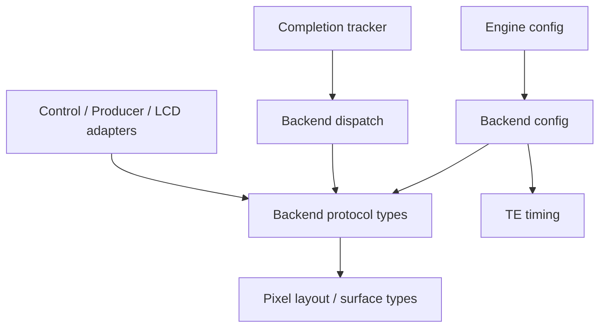

# 私有源码目录

本说明对应2026-11-06目录整理。目录表达职责归属；engine和backend相关头文件已按职责拆分；backend协议仍使用pixel头中的布局/像素类型，不能把本图当作所有依赖已经严格隔离的层级。

```text
src/
  esp_display_presenter.c      公共API、会话和兼容语义
  sources.cmake               IDF与Host共用的显式源码清单
  core/                       Engine、完成跟踪、传输期限跟踪
  config/                     模式策略、布局/内存规划、几何校验
  resources/                  硬件/内存资源组装、预算汇总与生命周期
  backend/                    FB/GRAM/TE协议、帧状态、覆盖与历史修复
  pixel/                      像素任务与转换接口
    executor/                 CPU/PPA/DMA2D执行插件
  platform/                   OS、LCD驱动适配、TE定时与同步
```

## 放置规则

- 新增文件按职责归入模块，src根目录保留公共入口与源码清单。暂不继续细分backend子目录；共享帧状态和历史修复仍在同一模块。
- 私有头文件与所属模块一起放置。引用使用相对src根目录的模块路径，例如`core/present_engine.h`、`platform/present_os.h`。构建只添加src根目录，不把所有模块目录加入搜索路径。
- include目录继续只承载公共API。esp_lv_present及维护中的测试依赖私有接口时，显式引用模块路径；这些私有路径不承诺对外兼容。
- 新生产C文件加入src/sources.cmake相应组。IDF与Host使用相同engine清单；Host的独立executor测试使用相同pixel/OS组，fake资源测试复用resources组。实际TE GPIO同步由IDF使用，Host依旧使用原有shim和专项测试。
- 本次保留文件基名、函数名和linker.lf映射。移动热路径后仍须检查目标ELF的IRAM放置，不能仅根据文件名推断映射生效。
- dev/evidence内历史快照和日志保持原样；它们记录历史路径，不作为维护源码入口。

## 私有接口职责

原core/present_presenter.h已拆分；维护代码按实际调用显式包含对应头文件，不依赖plan/resources的间接导出。

| 头文件 | 职责 | 主要依赖 |
|---|---|---|
| config/present_engine_config.h | backend选择、模式与engine创建配置 | backend配置、output caps |
| core/present_engine_types.h | 不透明engine句柄、区域、状态快照、receipt token | 标准类型与esp_err |
| core/present_engine.h | 原生运行时API；保留原owner/事件入口约束 | 配置和状态类型 |
| core/present_producer.h | owner专用预算与lease身份桥接 | 状态类型、backend协议 |
| core/present_control.h | 非owner的公共层控制入口及Host gate测试钩子 | 状态类型、backend协议 |
| core/present_session.h | 公共presenter与绑定之间的独占交接 | 状态类型 |

control中的查询/receipt操作沿用原gate序列化，stop/destroy要求生产者暂停；bind要求调用者排除包括native在内的生产者调用。头文件分离不是访问权限校验的替代，运行时检查仍由原实现承担。

resources/present_memory.h只前置声明backend/engine配置结构，保留内存预算声明，补齐C++的C linkage。为支持前置声明，原匿名engine配置结构增加tag，不改变字段或枚举。config/present_mode.h使用公共配置头及engine配置头；config/present_plan.h使用配置与句柄类型，只有其C实现为create_planned桥接显式包含运行时API。backend/present_output_caps.h改为独立标准类型头，completion_tracker不再依赖engine配置/API。

dev/tests/test_header_contracts.py现独立编译17个头文件的C/C++入口，并检查上述依赖边界；现有header_smoke覆盖memory接口的C++链接。

## Backend类型、配置与操作表

| 头文件 | 职责 | 明确不引入 |
|---|---|---|
| backend/present_backend_types.h | frame/lease/receipt、覆盖/状态、事件/故障、panel adapter回调与不透明backend/config声明 | 完整backend配置、backend操作表、TE timing |
| backend/present_backend_config.h | 完整配置结构、TE gate策略与timing参数 | backend操作表 |
| backend/present_backend.h | 后端操作表及GRAM/TE/FB三个实例声明 | 完整backend配置 |



backend操作表的create只接受配置指针，因此配置前置声明已足够；构造配置或读取字段的实现显式包含config头。控制、生产者桥接、LCD适配、transfer tracker、帧记录与事务只引用协议类型；completion tracker实际使用ops查询，因此继续显式引用操作表。

engine配置仍按值包含完整backend配置，符合其创建参数职责，但不再把backend操作表带给配置/规划消费者。backend协议类型目前仍从pixel/present_pixel_engine.h取得布局、surface和copy相关类型；本轮没有拆pixel头，也没有改变已有处理流程。

目录整理见[第一批证据](evidence/source-layout-20261106/README.md)，engine声明拆分见[第二批证据](evidence/header-contracts-20261106/README.md)，backend拆分见[第三批证据](evidence/backend-contracts-20261106/README.md)。
