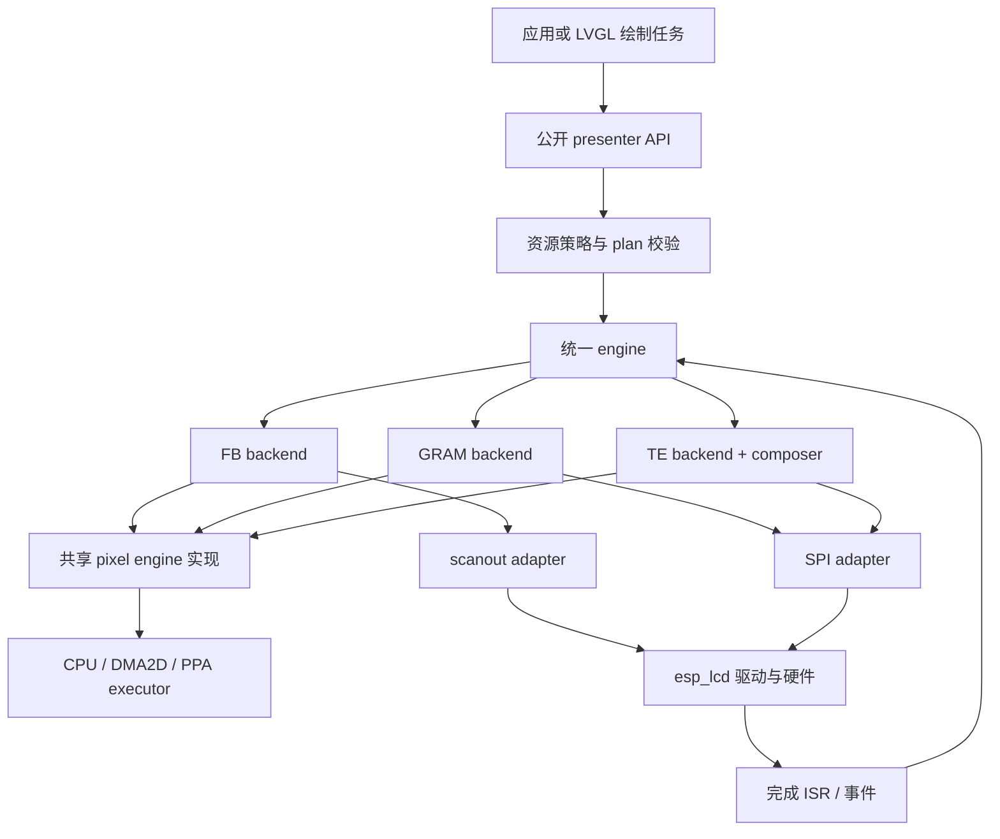
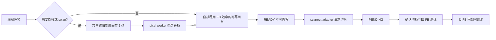
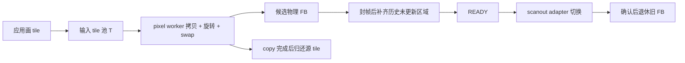
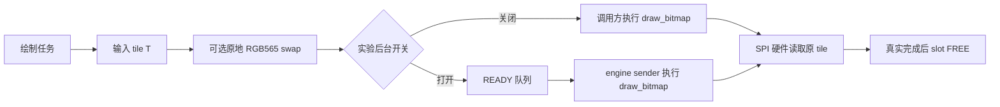
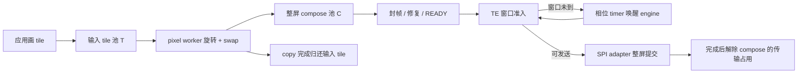
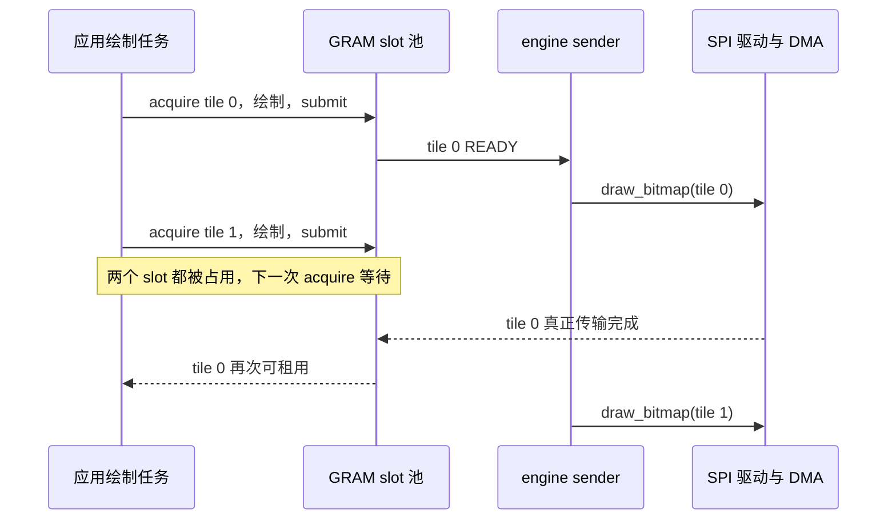

# 当前模式、缓冲、任务与像素处理审查

审查日期：2026-11-04。对象为当前 `esp_display_present` 目录里的新引擎实现，保留 V1 公共入口；不是旧归档目录的实现。

代码基线：`c260e7eb7`，加其后的 GRAM 后台提交原型。原型开关 `CONFIG_ESP_DISPLAY_PRESENT_GRAM_BACKGROUND` 默认关闭。本文区分默认行为和打开实验开关后的行为，不将原型当成默认功能。

本文用来看清当前公开工厂支持哪些模式。先看第 3 节的模式总表、第 3.1 节的准入和第 3.2 节的 slot 退休；后面各节是这些模式的缓冲、任务和所有权细节。实验开关单独标出，不算默认模式。

本文任务数量指 **ESP 实板上每个 presenter 新建的组件任务**，不包含应用绘制任务、LVGL 任务、IDF 共用 timer 服务、驱动内部资源及 ISR。缓冲数量指池容量，不等于可同时拿到的 lease 数或同时执行的硬件事务数。

## 1. 先看整体边界

图中“共享”是复用同一套实现；不同 presenter 各有自己的 engine、backend、pixel engine 和任务，不是多个显示器共用一个全局工作队列。

- **策略层**决定 FB 轮转、GRAM 区域发送、TE 整屏合成与发送时机。
- **pixel engine**处理拷贝、旋转和字节序，可以同步执行，也可以排入一个工作任务。
- **adapter**负责调用驱动、转换完成回调、维护硬件借用；SPI/scanout adapter 自己不创建发送任务。
- **engine sender**推进 backend；名字叫 sender，但在 FB 中主要推进修复、转换、切换等状态，不是额外复制整屏的任务。

依据：[公共入口](../src/esp_display_presenter.c#L575)、[资源策略](../src/present_resources.c#L117)、[engine 创建](../src/present_engine.c#L518)、[pixel worker 创建](../src/pixel/present_pixel_engine.c#L378)。

## 2. 数量符号与输入约束

| 符号 | 含义 | 当前公开配置支持 |
| --- | --- | --- |
| `W × H` | 输入逻辑尺寸 | 90°/270° 时输出物理宽高互换 |
| `B` | 每像素字节数 | RGB565 为 2，RGB888 为 3 |
| `R` | 每块绘制 tile 的高度，单位是行 | `drawbuf.lines`。0 时取约 32 KiB 能放下的整行数，至少 1、最多 H。这是高度，不是块数 |
| `T` | 分块绘制池的块数 | `drawbuf.buffers`，只作用于 PARTIAL、GRAM、TE。显式 1 或 2；0 自动选择。FULL/DIRECT 的画布块数不是这个字段 |
| `N` | FB 扫描缓冲数 | 由模式决定：NONE 为 1，DOUBLE 为 2，TRIPLE 为 3。配置入口是 `fb.frame_buffer_count`，不是 `drawbuf.buffers` |
| `C` | TE 整屏 compose 缓冲数 | `drawbuf.te_compose_buffers` 为 0/1 时取 1，为 2 时取 2 |
| `S` | SPI adapter staging 大小 | 不是绘制 tile，也不是 GRAM converted tile |

输入格式必须与 `hw.input_pixel_format` 一致；当前不做 RGB565/RGB888 之间的颜色格式转换。`swap_bytes` 只支持 RGB565，指每个 16 位像素的字节序交换，不是 RGB/BGR 通道交换。

**输入不是任意指针提交。** 公开路径先 acquire 得到 lease，再 submit 同一个 lease 和像素地址；不能拿应用自行分配的 framebuffer 替换该地址。可以借用公开 draw-buffer 池供 LVGL 绘制，但后续仍受 lease/所有权协议约束。门面一次只允许一个尚未提交的 lease；T=2 表示前一个提交后可获取另一个空闲 tile。

FULL/DIRECT 的“输入”是完整画布视图；PARTIAL/GRAM/TE 的“输入”是 tile。把 `R` 设成 H 只是把 tile 放大到整屏，并不会自动变成 FB 扫描模式。

依据：[公开配置](../include/esp_display_present_config.h#L88)、[公开 draw-buffer 视图](../include/esp_display_present.h#L221)、[lease 与地址校验](../src/esp_display_presenter.c#L575)、[行数和格式校验](../src/present_resources.c#L117)。

### 2.1 自动数量不等于固定双 tile

当前资源策略：

- 普通同步 GRAM 默认尝试 T=2。
- FB PARTIAL、TE、旋转/PSRAM GRAM，以及打开实验后台发送后的普通 GRAM，按后台重叠策略选择：单核取 1；多核在内部 DMA 堆满足两份 slot、预留资源以及 128 KiB 余量时取 2，否则取 1。
- 显式 `drawbuf.buffers=1/2` 优先。自动选到 2 后若创建失败为 `ESP_ERR_NO_MEM`，还有降到 1 的重试；显式数量不被悄悄改小。这次降级发生在 SPI adapter 已经创建之后，重试不重建 adapter，`max_inflight` 仍是降级前的 tile 数。FB 的扫描缓冲数不参与这次降级。
- `in_psram=true` 是优先放 PSRAM；资源不足时策略可能改用内部 DMA 内存，因此要看最终 plan，不能只看配置名。
- FULL/DIRECT 不创建 tile 池，`drawbuf.buffers` 不是它们的画布数量。

私有 plan 的 tile 上限为 16，copy ticket 上限为 64；**公开门面仍限制 T≤2**。不要把私有容量上限当成公开 API 已支持的输入数量。公开策略 `max_frames=8` 是帧记录容量，也不是 8 个像素缓冲。

依据：[默认数量](../src/present_resources.c#L94)、[自动降级](../src/present_resources.c#L460)、[plan 池规划](../src/present_plan.c#L209)、[内部上限](../src/present_limits.h#L11)。

## 3. 所有公开模式总表

公开工厂按面板类型收口，不存在表外的模式：

- **RGB / MIPI DSI** 支持 `NONE`、`DOUBLE_FULL`、`TRIPLE_FULL`、`DOUBLE_DIRECT`、`DOUBLE_PARTIAL`、`TRIPLE_PARTIAL`。不支持 `TE_SYNC`，也不存在 `TRIPLE_DIRECT`。
- **SPI / IO** 支持 `NONE` 和 `TE_SYNC`。不支持任何 FB 模式。
- **`AUTO` 不是新模式**。RGB/DSI 选 `TRIPLE_PARTIAL`；IO 有有效 TE 配置选 `TE_SYNC`，否则选 `NONE`。

表中任务数按当前公开 factory 计算；P 为拷贝任务，E 为 engine sender。默认情况下 FB 和 TE 都设置 `async_copy=true`、`background_service=true`，即使某条具体路径不需要拷贝，也会创建这两个任务。T 从 1 变 2 只多一块 tile，不多一条 worker。

| 面板 / 模式 | 应用输入池 | 输出像素池 | 独立 converted 池 | P / E / 合计 | 主要处理 |
| --- | --- | --- | --- | --- | --- |
| RGB/DSI `NONE` | 单 FB；需转换时为 1 张逻辑画布 | N=1 扫描 FB | 无独立 tile 转换池 | 1 / 1 / 2 | 直接写当前扫描缓冲；需时整屏转换 |
| RGB/DSI `DOUBLE_FULL` | 2 FB 轮流租用；需转换时共享 1 张逻辑画布 | N=2 | 同上 | 1 / 1 / 2 | 每帧全屏覆盖，必要时整屏旋转/swap |
| RGB/DSI `TRIPLE_FULL` | 3 FB 轮流租用；需转换时共享 1 张逻辑画布 | N=3 | 同上 | 1 / 1 / 2 | 比双 FB 多一个排队/绘制槽位 |
| RGB/DSI `DOUBLE_DIRECT` | 2 FB 轮流租用；需转换时共享 1 张逻辑画布 | N=2 | 同上 | 1 / 1 / 2 | 整屏地址空间内更新脏区，保留/修复旧内容 |
| RGB/DSI `DOUBLE_PARTIAL` | T=1/2 tile | N=2 | 0 | 1 / 1 / 2 | tile 直接拷贝/旋转/swap 到目标 FB |
| RGB/DSI `TRIPLE_PARTIAL` | T=1/2 tile | N=3 | 0 | 1 / 1 / 2 | 同上，多一个 FB 槽位 |
| IO `NONE`，0°、内部 tile，实验关 | T=1/2 tile | 发送输入 tile 自身 | 0 | 0 / 0 / 0 | 原地可选 swap，前台调用驱动 |
| IO `NONE`，0°、内部 tile，实验开 | T=1/2 tile | 发送输入 tile 自身 | 0 | 0 / 1 / 1 | 原地可选 swap，READY 后后台调用驱动 |
| IO `NONE`，非零旋转或配置 PSRAM | T=1/2 tile | T 个 converted tile | T | 1 / 1 / 2 | 输入→独立输出，异步像素处理后发送 |
| IO `TE_SYNC`，C=1 | T=1/2 tile | C=1 整屏 compose | 0 | 1 / 1 / 2 | tile→整屏，TE 准入后发送 |
| IO `TE_SYNC`，C=2 | T=1/2 tile | C=2 整屏 compose | 0 | 1 / 1 / 2 | 可合成下一帧并发送上一帧 |

FULL/DIRECT 的 N 个 FB 是池总数，包含正在扫描的那一个，不代表 N 个都可写；需转换时 N 个 FB 也不对应 N 张独立逻辑画布。转换条件为旋转非 0°，或者输入/输出字节序不一致。

依据：[模式映射和 async 决策](../src/present_resources.c#L149)、[模式合同归一化](../src/present_plan.c#L12)、[FB 物理/逻辑存储](../src/backend/present_backend_fb.c#L730)、[GRAM 存储](../src/backend/present_backend_gram.c#L289)。

### 3.1 下一帧什么时候可以开始

上表的池容量和任务数不表示绘制已经和输出重叠。`fb_begin` 只接受 `FREE` 槽；没有空槽时返回 `ESP_ERR_NO_MEM`，engine 在这个错误上等待，直到出现空槽或超时。N=1 是例外，允许写当前正在扫描的那一张。

| 模式 | begin | 下一次驱动提交 | 实际能重叠的事 |
| --- | --- | --- | --- |
| RGB/DSI `NONE` | 可以写正在扫描的那一张 | 公开工厂不设置 `single_boundary_retire`，且 N=1 不做 ISR join，因此固定等 2 个边界。cookie 还在时提交被拒绝 | 可以边扫边画同一张。没有双缓冲隔离 |
| `DOUBLE_FULL` / `DOUBLE_DIRECT` / `DOUBLE_PARTIAL` | 必须还有一张 `FREE`。一张 `SCANNING`、另一张 `FREE` 时可以开始下一帧；两张都离开 `FREE` 时再下一帧等待 | N>1 时先做 ISR join：成功则后续 1 个边界，join 不可用则 2 个。同时只有一个待确认切换 | 绘制可以和当前扫描重叠一帧。旧扫描槽退休后才有下一张 `FREE`。copy worker 和 sender 不改变这个槽位规则 |
| `TRIPLE_FULL` / `TRIPLE_PARTIAL` | 三张里有一张 `FREE` 即可 | 边界规则与双缓冲相同 | 可以一张在画、一张已提交待确认、一张在扫描 |
| `DOUBLE_DIRECT` 的像素 | 目标槽换成另一张基线，且本帧不是 full redraw 时，begin 先预填旧内容 | 同该缓冲数的 FB 规则 | 预填使用已有 copy worker，不新增任务。公开门面在首帧、无损伤、损伤超过 32 块、整屏脏、滚动，以及取消、旋转或重新绑定之后，把本帧标成 full redraw，这些情况跳过预填 |
| IO `NONE`，0°、内部 tile，实验关 | 有空闲 slot 即可 | 调用方线程里 `draw_bitmap`。返回后 DMA 仍可能继续读这块 tile | 没有组件任务。T=2 时另一块 tile 可以画，驱动调用仍可能堵住调用方 |
| IO `NONE`，0°、内部 tile，实验开 | 有空闲 slot 即可 | 只有 sender 调用驱动，调用期间放开 engine gate | 多出来的是这一条 sender，不是第二块缓冲 |
| IO `NONE`，旋转或 PSRAM | source 和 converted 整个 slot 都空闲才能再租 | 传输结束才归还整槽 | T=2 的两槽都在发送时，下一次 acquire 等待 |
| IO `TE_SYNC`，C=1 | 正在发送的那张 compose 不能同时写 | 一次只提交一个整屏，并且要等 TE 窗口 | 两个输入 tile 不能变成两张整屏流水线 |
| IO `TE_SYNC`，C=2 | 另一张 compose 可以建下一帧；正在被修复引用的 baseline 仍不可改 | 仍一次只发送一张 | 下一帧合成可以和上一帧传输重叠 |

逐帧调用 `quiesce` 会把上表的扫描等待算进每一帧。那样算出来的是回合时间，不是连续提交能达到的帧率。

### 3.2 单缓冲和多缓冲：每个执行 slot 何时退休

这里的执行 slot 是一帧从绘制走到输出完成所占的那一格。它和输入 tile 不是同一次退休。FB 的执行 slot 是 `fb_slot_t`，数量是 N。GRAM 的执行 slot 是 `gram_slot_t`，数量是 T，source 和 converted 绑在同一格上。TE 的执行 slot 是 composer 里的整屏图像，数量是 C；输入 tile 另算。

#### FB

执行 slot 的状态是 `FREE`、`PREFILL`、`DRAWING`、`DRAIN_TILE`、`REPAIR`、`CONVERT`、`READY`、`SUBMITTING`、`PENDING`、`SCANNING`。`present_fb_service` 在 `PENDING` 且已经收到匹配的 `SCANOUT_CONFIRMED` 时退休。同时只有一个 `pending`。

| N | begin 选哪一格 | 确认之后 |
| --- | --- | --- |
| 1 | `FREE`，或者当前这张已经是 `SCANNING`。选中后立刻改成 `DRAWING` 或 `PREFILL`，`scanning` 下标仍指着这张 | 确认的就是同一格：丢掉 `TRANSFER` 引用，原有 `SCANOUT` 引用保留，状态写回 `SCANNING`。没有第二张可变成 `FREE` |
| 2 或 3 | 只选 `FREE`。`SCANNING`、`PENDING`，以及封帧后的 `DRAIN_TILE` / `REPAIR` / `CONVERT` 都不会被选中 | `scanning` 和 `pending` 不是同一格：旧格丢掉 `SCANOUT`，状态变为 `FREE`；新格丢掉 `TRANSFER`、加上 `SCANOUT`，状态变为 `SCANNING` |

N=1 的可写窗口是：上一帧已经回到 `SCANNING`，下一帧把这张改成 `DRAWING`，面板仍在扫这块像素。一旦这帧提交成功，状态进入 `PENDING`，再下一帧的 begin 要等确认。公开工厂不设置 `single_boundary_retire`，N=1 也不做 ISR join，所以这次确认固定等 2 个 `frame_buf_complete`。cookie 还在时，下一次 `draw_bitmap` 被拒绝。

N=2 的稳态是一张 `SCANNING`、另一张可以 `DRAWING`。后一张提交后变成 `PENDING`，此时没有 `FREE`，第三帧要等旧扫描格退休。N=3 可以同时有一张 `SCANNING`、一张 `PENDING`、一张 `FREE` 或 `DRAWING`。N>1 的确认边界：提交成功后先做 ISR join，成功则再等 1 个已布防的 `frame_buf_complete`，join 不可用则等 2 个。

PARTIAL 的输入 tile 更早退休。异步提交立刻清掉 lease id，但 `copy` ticket 还在时 `fb_acquire` 返回 `ESP_ERR_TIMEOUT`。`progress_copy` 看到拷贝结束后清掉 ticket，这块 tile 才能再租。同步路径则在 `pixel_wait` 返回后清 lease。tile 退休不把 FB 执行 slot 从 `SCANNING` 改成 `FREE`。

DIRECT 的预填发生在被选中的那一格内部：`PREFILL` 完成后进入 `DRAWING`。这不是另一格的退休。构建失败时，若这格就是 `scanning` 指向的那张，状态回到 `SCANNING`；否则回到 `FREE`。N=1 失败还会清掉 baseline。

#### GRAM

每个执行 slot 的状态是 `FREE`、`LEASED`、`COPYING`、`READY`、`SUBMITTING`、`INFLIGHT`。转换路径的 source 和 converted 共用这一格的 `storage`，只在整格退休时一起交还。

退休点是匹配 cookie 的 `TRANSFER_DONE`，并且事务已经被标记完成。`complete_slot` 丢掉 `COPY` 和 `TRANSFER` 引用，状态变为 `FREE`，帧记录完成。`FAULT` 只记下错误，不把槽收回。驱动拒绝时槽回到 `READY`，已经做好的像素继续占着这格。

| T | 下一格何时能租 | 这一格何时退休 |
| --- | --- | --- |
| 1 | 这一格离开 `FREE` 之后，acquire 没有另一格 | 同上，等这一格的 `TRANSFER_DONE` |
| 2 | 另一格仍是 `FREE` 时可以 `LEASED`，并在异步路径上进入 `COPYING` | 各自等自己的 `TRANSFER_DONE`。`SUBMITTING` 加 `INFLIGHT` 的格数达到 `transfer_capacity`（默认等于 T）时，新的 `READY` 先不提交 |

0° 内部 tile 没有 `COPYING`。`draw_bitmap` 返回后，DMA 仍可能在读这格，状态停在 `INFLIGHT`，直到完成回调。实验后台只是改成由 sender 调用驱动，退休条件仍是这个回调。

#### TE

输入 tile 和整屏 compose 各退一次。

tile 在提交成功时清掉 lease id。`copy` ticket 还在时 `te_acquire` 不会再租这块。`progress_copies` 确认写入 compose 结束后清掉 ticket，tile 回到可租。这一步不等整屏传输结束。

compose 图像的状态是 `IDLE`、`BUILDING`、`REPAIR`、`READY`、`INFLIGHT`。一次只提交一张。另一张即使已经 `READY`，也要等当前 `SUBMITTING` / `INFLIGHT` 结束，并且更早的帧先发送。传输完成且事务标记完成后，`present_te_composer_complete` 丢掉 `TRANSFER` 引用，该 job 变为 `IDLE`。

| C | 下一帧 begin 选哪张 | 传输完成后谁可写 |
| --- | --- | --- |
| 1 | 唯一一张必须是 `IDLE`。它处于 `BUILDING`、`READY` 或 `INFLIGHT` 时，begin 拿不到图像 | 这张变回 `IDLE`。C=1 允许下一帧再选它，包括它已经是 baseline |
| 2 | 选一张 `IDLE`，并且下标不是当前 baseline。正在发送的那张和 baseline 都不能当下一帧的绘制目标 | 发送中的那张变回 `IDLE`。baseline 在封帧时已经指向刚准备好的那张，完成回调不改 baseline。另一张若是 `IDLE` 且不是 baseline，就可以开始下一帧 |

公开配置的 C=0 在工厂里改成 C=1，走上面第一行。私有 composer 直接传 0 时是两张图且 `pipelined=false`：只要还有 job 不是 `IDLE`，begin 就返回 `ESP_ERR_INVALID_STATE`。

依据：[FB 确认后退休](../src/backend/present_backend_fb.c#L553)、[FB begin 选槽](../src/backend/present_backend_fb.c#L858)、[FB tile 再租条件](../src/backend/present_backend_fb.c#L982)、[GRAM 整槽退休](../src/backend/present_backend_gram.c#L69)、[GRAM 完成回调](../src/backend/present_backend_gram.c#L193)、[TE tile 再租条件](../src/backend/present_backend_te.c#L663)、[TE compose 完成](../src/backend/present_te_composer.c#L365)、[TE 选下一张图](../src/backend/present_te_composer.c#L141)。

## 4. FB 模式：扫描池与绘制池

### 4.1 FULL / DIRECT

- **FULL** 要求一帧完整覆盖；0°、同字节序时应用直接画入 FB，不需要整屏复制。
- **DIRECT** 仍提供整屏寻址，但只声明/更新部分区域。切换到不同基线的目标时先预填；封帧后结合历史损伤修复未写区域。本帧被标成 full redraw 时跳过预填。公开门面何时这样标，见第 3.1 节。
- **旋转/swap 路径** 为 FULL/DIRECT 额外分配一张逻辑整屏画布；各物理 slot 引用同一张画布，封帧后转换到各自物理扫描 FB。不能理解成“双 FB 再额外配两张逻辑 FB”。
- **NONE** 不再属于这条扫描池路径。RGB/MIPI DSI均使用PARTITION tile，通过`draw_bitmap()`复制脏区到驱动内部 framebuffer；允许撕裂，但present不借用当前扫描FB作为持久画布。
- RGB/DSI FB 由面板驱动提供，组件借用，不再为每个 slot 新分配同等大小的扫描 FB。用户提供地址时必须与驱动查询到的池一致。

依据：[状态机说明](../src/backend/present_backend_fb.c#L17)、[创建与逻辑画布共享](../src/backend/present_backend_fb.c#L730)、[begin/预填](../src/backend/present_backend_fb.c#L836)、[借用驱动 FB](../src/present_resources.c#L380)。

### 4.2 PARTIAL

PARTIAL 没有另配 T 个 converted tile，也没有逻辑整屏中转：每个 tile 直接处理到目标物理 FB。旋转发生在 tile 写入阶段；封帧时不再把整张 FB 旋转一遍。候选 FB 与 baseline 之间的修复仍可能产生额外拷贝。

**源 tile 的 copy 完成和物理 FB 退休是两件事。** tile copy 完成即可复用输入 tile；物理 FB 只有确认被替换且不再被扫描借用后才能重新写。

依据：[tile copy 回收](../src/backend/present_backend_fb.c#L274)、[封帧/修复/转换](../src/backend/present_backend_fb.c#L350)、[区域提交](../src/backend/present_backend_fb.c#L1029)。

### 4.3 当前退休节拍

N=1 和 N>1 各自哪一格变 `FREE`、哪一格保持 `SCANNING`，见第 3.2 节。这里只记确认边界怎么数。

多 FB（N>1）提交成功后执行 ISR barrier，先等待可能已经开始执行、仍采样旧状态的 ISR 退出，再 arm 后续边界。join 成功取一个边界，否则保留两个边界回退。join 与后续扫描确认的语义不能省略成“draw_bitmap 返回就能释放旧 FB”。

这条 join 只在 `buffer_count > 1` 时执行。公开工厂不设置 `single_boundary_retire`，因此 `NONE`（N=1）固定等两个边界。N=1 在状态回到 `SCANNING` 后可以再画这张，提交后的 `PENDING` 期间不能开始再下一帧；下一次 `draw_bitmap` 还要等 cookie 清除。双缓冲在一张 `SCANNING`、另一张 `FREE` 时可以开始下一帧，见第 3.2 节。

只有一个待确认的扫描切换；三 FB 增加准备/排队空间，没有增加发送任务，也不是让三张 FB 同时扫描。

依据：[提交和 arm 边界](../src/platform/present_lcd_scanout.c#L156)、[N=1 不 join](../src/platform/present_lcd_scanout.c#L203)、[确认后退休](../src/backend/present_backend_fb.c#L546)、[begin 只接受 FREE 槽](../src/backend/present_backend_fb.c#L858)、[ISR join 验证记录](../dev/FB_ISR_JOIN_RESULTS_20261103.md)。

## 5. GRAM：直接发送、转换发送与实验后台发送

### 5.1 普通内部 tile，0°

默认不创建组件任务。`draw_bitmap()` 可能在等待交易描述符、命令或驱动分包时阻塞；函数返回后，DMA 也可能继续读取源地址。因此默认“没有发送任务”不代表硬件传输是同步完成的。

swap 在提交驱动之前原地处理当前租用的 tile；输入 tile 会改变字节内容。下一次取得它时应按新提交所需内容重新绘制，不能假定旧字节仍是原始顺序。0°原地 swap 可以安全做；旋转不能沿用这条原地策略。

打开实验开关后，只给这一类 `async_copy=false` 的 GRAM 增加 **1 个 engine sender**：像素准备仍在前台，之后发布 READY；真正 driver call 在后台。当前 prototype 在 driver call 期间暂时释放 engine gate，让生产者可操作另一空闲 tile；只有 sender 被允许真正提交驱动。没有增加第二套发送任务或复制池。

依据：[像素准备](../src/backend/present_backend_gram.c#L439)、[区域提交](../src/backend/present_backend_gram.c#L548)、[后台 driver 包装](../src/present_engine.c#L187)、[实验配置](../Kconfig)。

### 5.2 旋转或 PSRAM tile

每个 slot 有 **source + converted 两块不同的像素内存**。90°/270°转换后的 tile 宽高交换，但像素数量不变。旋转和 swap 可在同一次像素处理请求中完成；转后再由 SPI 发送物理区域和物理 tile。

即使“PSRAM、0°、不 swap”，当前工厂仍打开 async copy，配置独立内部 DMA converted 池：不是把 PSRAM 原指针直接交给 SPI。PSRAM 不够而回退内部内存时，策略仍按原始配置开启异步路径。

**当前 source/converted 成对占用一个 slot。** copy 完成后进入 READY，并不会把 source 单独提前归还给绘制方；直到传输结束才使整个 slot 可再租用。这与 FB/TE 的 tile 在 copy 后即可归还不同，是后续池解耦的候选点。

这条路径原本就有 1 个 copy worker + 1 个 sender。实验开关没有把它改成新的 deferred 策略；普通内部路径的实测结果不能套到这里。默认 service 也可能由前台操作触发，不保证每次真实 driver call 都发生在 sender 线程中。

依据：[成对分配](../src/backend/present_backend_gram.c#L289)、[service 与 slot 回收](../src/backend/present_backend_gram.c#L69)、[PSRAM 策略](../src/present_resources.c#L201)。

## 6. TE：输入 tile 与整屏合成池独立

- 输入 T=1/2，与 compose C=1/2 独立，可形成 T1C1、T2C1、T1C2、T2C2。
- tile 直接转换到**物理方向的 compose 图像**，没有 T 个额外 converted tile。合成结束后的历史修复使用物理坐标，不再旋转整屏。
- C=1 时发送借用与下一帧写入同一图像不能重叠；即便 T=2，也不能凭两个 tile 得到两张整屏流水线。
- C=2 时可用另一张 compose 构建下一帧，但 baseline/修复引用仍须遵守不可改写约束；不是任意两张图像都能自由写。
- 一次只推进一个整屏输出事务；C=2 不代表同时对两个整屏调用发送。
- TE 边沿负责周期/相位信息，phase timer 负责尚未到窗口时再唤醒。ESP 版本使用系统 `ESP_TIMER_TASK`，只新增 timer 对象，**不新增一个专用 TE 等待任务**。Host timer 实现用 pthread，不用于本表实板任务计数。
- 公开配置 C=0 表示 C=1；私有 composer 直接传 0 的兼容语义却是“两张图像、非 pipelined”，不能拿后者解释公开默认值。

依据：[TE 创建](../src/backend/present_backend_te.c#L441)、[tile 回收](../src/backend/present_backend_te.c#L173)、[窗口准入与发送](../src/backend/present_backend_te.c#L197)、[composer 写入](../src/backend/present_te_composer.c#L173)、[timer 实板实现](../src/platform/present_te_timer.c#L131)。

## 7. 两种 work、硬件执行器与真实传输数量

| 对象 | 每 presenter 数量 | 做什么 | 不应混淆的数量 |
| --- | --- | --- | --- |
| copy worker | async_copy=true 时 1，否则 0 | 从 ticket 队列串行取工作，执行 CPU 或硬件像素请求 | T 个 ticket 容量不等于 T 个 worker |
| engine sender | background_service=true 时 1，否则 0 | 处理进度唤醒，推进 backend 状态与发送 | 不因双/三 FB 或 C2 而增加 |
| CPU/DMA2D/PPA executor | CPU 必建；异步路径尝试创建两种硬件插件 | 能力探测与执行 | 插件自身不各创建一条组件 worker |
| SPI adapter | 1 个对象、0 个任务 | draw_bitmap、cookie、完成 ISR、可选 staging | max_inflight 是 buffer/事务容量 |
| scanout adapter | 1 个对象、0 个任务 | 请求切换、回调关联、退休边界 | 连续扫描不是 sender 不断复制整屏 |
| TE timer | TE 有 1 个 phase timer 对象 | 相位到时通知推进 | 不是额外专属 FreeRTOS 任务 |

当前任务默认栈分别为 4096 B。sender 默认优先级 5；实验普通 GRAM 使用独立配置，默认 7。copy worker 初始优先级 5，首次成功提交时记录生产者优先级，由活着的 worker 自行应用。这里的“生产者”是对该 pixel engine 提交请求的任务，不应一概理解成应用主任务。

0°优先 DMA2D；旋转优先 PPA。首选不存在时尝试 PPA/CPU；请求不满足硬件能力时，执行前 probe 可选 CPU fallback。硬件已接受后发生错误，不再次用 CPU 覆写目标。支持与否取决于 SoC、IDF、格式、地址、步幅、对齐及旋转组合，不保证每次都用硬件。

pixel engine 主要是像素搬运/坐标旋转/字节序处理，不提供 alpha 混合、缩放、任意格式转换等通用图形流水线。

依据：[pixel worker 与优先级](../src/pixel/present_pixel_engine.c#L318)、[sender 创建](../src/present_engine.c#L550)、[执行器选择](../src/present_resources.c#L294)、[probe/fallback](../src/pixel/executor/present_executor.c#L43)。

### 7.1 池容量与实际并发

| 路径 | copy ticket 配置容量 | pixel worker 数 | 待确认输出容量 |
| --- | --- | --- | --- |
| FB FULL/DIRECT | 1 | 1 | 1 |
| RGB/DSI NONE PARTITION | T | 1 | 1 |
| FB PARTIAL | T | 1 | 1 |
| 普通同步 GRAM | T，执行为同步 | 0 | 至多 T，受 adapter 限制 |
| 实验后台普通 GRAM | T，像素准备仍同步 | 0 | 至多 T，受 adapter 限制 |
| 旋转/PSRAM GRAM | T | 1 | 至多 T，受 adapter 限制 |
| TE | T，合成和修复共享 pixel engine | 1 | 1 |

ticket 容量是正在使用的像素请求记录上限，并非每个请求都同时执行。一个 worker 串行推进这些请求，硬件执行等待也在该工作链路内。

下面以实验 GRAM、T=2 为例说明：后台返回早，不会额外创造可写 buffer。

依据：[FB pixel 配置](../src/backend/present_backend_fb.c#L788)、[GRAM pixel 配置](../src/backend/present_backend_gram.c#L306)、[TE pixel 配置](../src/backend/present_backend_te.c#L485)。

### 7.2 驱动调用与总线分包

GRAM 的逻辑传输容量默认至多 T，受 adapter 的 max_inflight 限制；FB/TE 的待确认输出容量为 1。SPI 总线上实际仍按总线序列传输；多个 inflight 表示多个逻辑源 buffer 仍被驱动持有，不代表并行多条 SPI 线缆。

一次 `esp_lcd_panel_draw_bitmap()` 还可能被 IDF 拆成多个 SPI transaction；驱动的 transaction queue 深度不等于组件任务数，也不等于输入 tile 数。函数可能因分包入队背压而等待，后台发送能否增益取决于这段等待能否与另一个 buffer 的绘制重叠。

## 8. 三种容易混淆的中间 buffer

| 名称 | 归属 | 数量 / 大小 | 用途 |
| --- | --- | --- | --- |
| GRAM converted | GRAM backend slot | T 个，每个约 `W×R×B` | 输出旋转、swap、PSRAM→内部 DMA；与 source 成对 |
| TE compose | TE composer | C 个，每个 `W×H×B` | 形成可按 TE 窗口发送的整屏 |
| SPI staging | SPI adapter | 有则 1 个，大小 S | 不可直接 DMA 的输入，分段搬入内部 DMA 内存 |

当前公开普通 GRAM 创建 SPI adapter 时 `staging_bytes=0`；PSRAM 路径使用 backend converted，并不是自动给 SPI adapter 配 staging。

TE 创建时根据驱动只读事实判断 `psram_dma_direct`。支持时 SPI staging=0；否则计算约 32 KiB staging，并要求它能容纳整个物理帧，放不下便返回 `ESP_ERR_NOT_SUPPORTED`。所以不能声称“所有不支持 PSRAM DMA 的屏都能靠 32 KiB staging 跑 TE”。即便 compose 分配回退内部内存，当前这项创建期限制也仍按资源策略执行。

adapter 的 staging 实现会 copy→cache 同步→draw→等该段完成后再复用同一块 staging，强制 max_inflight=1。只有最终段完成才发布逻辑完成。TE 的创建校验避免走多段 panel 窗口发送；这与驱动在一次窗口内部拆 SPI 包不同。

依据：[SPI 资源创建与 TE 校验](../src/present_resources.c#L414)、[stage_transfer](../src/platform/present_lcd_spi.c#L154)、[staging 分配与容量](../src/platform/present_lcd_spi.c#L320)。

## 9. 像素内存账本

以下为像素负载估算，未包含对齐、堆管理、任务栈、控制结构、驱动 DMA 描述符、RGB bounce buffer、损伤历史等。

| 路径 | 像素内存组成 |
| --- | --- |
| FB FULL/DIRECT，0°同字节序 | 驱动 FB：`N×W×H×B`；组件不另分配同尺寸画布 |
| FB FULL/DIRECT，需转换 | 驱动 FB + 1 张共享逻辑画布：`N×W×H×B + W×H×B` |
| RGB/DSI NONE PARTITION | 驱动内部 FB + tile：`W×H×B + T×W×R×B` |
| FB PARTIAL | 驱动 FB + tile：`N×W×H×B + T×W×R×B` |
| GRAM 普通内部 | tile：`T×W×R×B` |
| GRAM 异步转换 | source + converted：`2×T×W×R×B` |
| TE | tile + compose + 可选 SPI staging：`T×W×R×B + C×W×H×B + S` |

FB/TE 共用 image repair 实现：矩形集合能表示覆盖时不分配每像素位图；碎片过多时才惰性分配约 `ceil(W×H/8)` 的覆盖率位图。plan 中 coverage 字节预算不是每次创建都已经分配的常驻像素池。

例如 480×480 RGB565、R=16：一块 tile=15 KiB，整屏=450 KiB。T2 普通 GRAM 输入负载 30 KiB；T2 转换 GRAM 为 60 KiB；T2C2 TE 为 930 KiB，再加可能存在的 S。两块整屏 tile 为 900 KiB；若走 source+converted 路径则约 1800 KiB，其中内部 DMA converted 是否分得出来要另外判断。

依据：[plan 的四种池](../src/present_plan.c#L361)、[惰性覆盖率位图](../src/backend/present_image_repair.c)。

## 10. 所有权与旋转支持边界

| 路径 | 输入什么时候能再次写 | 输出什么时候能再次写 |
| --- | --- | --- |
| FB PARTIAL | 对应 copy 真正完成后，归还 tile 池 | 该 FB 不再被扫描借用并满足修复引用约束后 |
| FB FULL/DIRECT 无转换 | 提交后的物理画布受扫描所有权限制 | 同左；返回成功不代表旧扫描已经退休 |
| FB FULL/DIRECT 有转换 | 逻辑画布经转换与状态推进后才可进入下一次合法租用 | 物理 FB 等退休 |
| GRAM 直接/转换 | 整个 slot 等真实传输完成，转换路径也不提前拆分归还 source | 同一个 slot 一起回收 |
| TE | tile copy 真正完成后归还 | compose 等传输和 baseline 等引用解除后可改写 |

以上“可复用”指通过下一次合法 acquire 重新获得写权，不能凭回调时间猜测后直接改旧指针。timeout 只结束等待，不证明 DMA 或扫描已停止；不确定提交错误也必须保留相关像素到完成/安全停机。

**创建时旋转**：代码提供 0/90/180/270°；RGB565 可组合 swap，RGB888 不支持 swap。创建旋转矩阵的实板记录与运行时 set_rotation 记录要分开看。

**运行时旋转尚有已记录限制**：[旋转专项报告](../dev/MODE_ROTATION_RESULTS_20261103.md)记录 P4 非方屏跨轴切换 56/84 项失败，以及 S31 从同步原地 swap 路径转向非零角度被拒绝。当前资源层仍按逻辑尺寸更新 scanout 视图，因此本文件不把“创建时四角度通过”写成“运行时任意切换已通过”。这些专项结果来自其报告所列版本/驱动条件，本次整理文档没有重跑板测。

## 11. 本次 review 建议重点看什么

1. **任务创建是否按实际工作收敛**：当前 FB 0° FULL/DIRECT 也建 copy worker；T1/T2 变化不会使任务数从 1 变 2。`esp_display_present_drawbuf_config_t.buffers` 的注释仍写“多一个 buffer 和 4 KiB worker 栈”，与创建代码不符：FB/TE 的 worker 本来就在，T=2 只多一块 tile。
2. **GRAM source/converted 池耦合是否值得解开**：现在 T 个 source 都可能因 converted 正在发送而被整体占用；解耦能改善复用，但需新增独立配额和所有权，不是提前 FREE 原 slot 即可。
3. **sender 能否统一**：FB/GRAM/TE 已共用 engine sender 实现；普通 GRAM 原型新增的是调度策略，没有新增 adapter 线程。TE 的窗口准入和 FB 的退休确认仍是各自的策略，不能合并成同一个完成条件。
4. **整屏 GRAM 的内存与收益**：R=H 可减少上层 tile 提交次数，却可能放大内部 converted 占用；PSRAM 整屏目前不会自动变成直连零复制。至少两个独立可写源才有绘制/发送重叠空间，单源主要是把等待从 submit 移到 acquire。
5. **模式准入和实测口径**：每种模式下一帧能重叠什么，以第 3.1 节为准。逐帧 `quiesce` 会把扫描确认算进每一帧，双缓冲因此接近面板帧周期，不能把这个数当成连续提交帧率。三缓冲可以藏住一帧。GRAM 后台原型另有一组 S31 16 行 tile 实测：普通 T2 合成吞吐 37.13→37.59 次/秒，submit 累计 23.51→4.04 ms/帧，acquire 1.30→20.78 ms/帧。等待从 submit 挪到了 acquire，不能据此证明整屏、TE、FB 或 LVGL 提帧。详见[原型实测](../dev/GRAM_BACKGROUND_RESULTS_20261104.md)。

本文为当前实现的代码审查清单；新增的是文档，没有据此修改调度、内存数量、旋转行为或启用实验开关。
