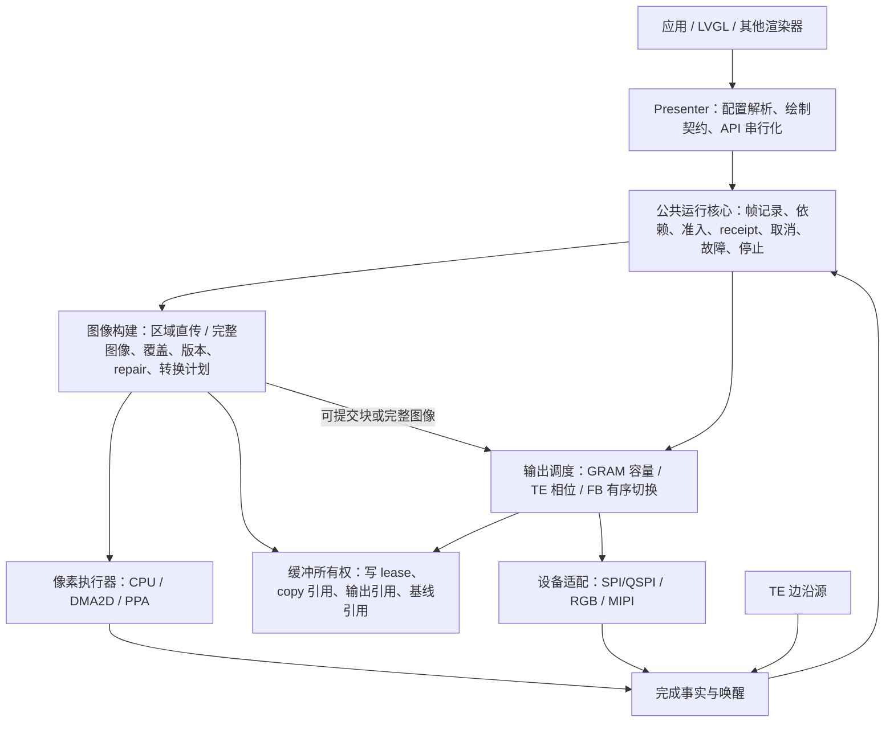
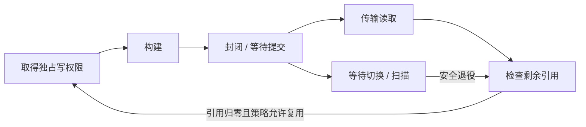

# V2 全局架构与模式设计草案

日期：2026-10-30。状态：全局目标与职责边界；用户已授权实施，当前落地/偏差见 PLAN.md 和 DESIGN_REVIEW.md。

源码盘点见 [MIGRATION_AUDIT.md](MIGRATION_AUDIT.md)，公开配置与内部潜在能力以该审计区分。

本文重新审视整个框架，不在现有三个完整后端上逐项叠加功能。公共核心和共享图像构建现已接入生产代码。模块图表示职责，不预先承诺目录、文件数量或新的函数指针表。实施顺序见 [PLAN.md](PLAN.md)。

## 1. 设计起点与已有缺口

现有 V2 在 lease、提交接受性、超时保留资源、完成回执等方面已有验证，但这不证明 V1 功能迁移完整。三个垂直后端重复帧生命周期和图像维护；TE 固定窗口、单活动帧、固定双 compose 尚不能表达 V1 的相位调度和多帧流水线。

当前已核对的源码依据：

- V1 模式与配置：[esp_display_present_config.h](../esp_display_present/include/esp_display_present_config.h)、[present_mode_ops.c](../esp_display_present/src/producer/mode/present_mode_ops.c)。
- V1 TE 相位：[present_te.c](../esp_display_present/src/platform/present_te.c)。
- V1 compose 分配、周转与发送：[present_te_render.c](../esp_display_present/src/producer/present_te_render.c)、[present_te_pool.c](../esp_display_present/src/producer/present_te_pool.c)、[present_te_transport.c](../esp_display_present/src/producer/stage/present_te_transport.c)。
- V2 契约与实现：[present_backend.h](include/present_backend.h)、[te.c](src/backend/te.c)、[te_composer.c](src/backend/te_composer.c)、[fb.c](src/backend/fb.c)、[present_records.h](src/present_records.h)。

以下是模式基线和目标设计，不是完整源码审计的完成声明。逐项行为、默认值、限制和证据还需在计划 P1 中核对。

## 2. 模式由四个维度组成

| 维度 | 内容 | 决定什么 |
| --- | --- | --- |
| 输出方式 | GRAM 区域传输、TE 同步完整图像传输、连续 FB 扫描 | 提交条件与硬件释放条件 |
| 绘制契约 | PARTIAL（后端 PARTITION）、FULL、DIRECT | 可写区域、旧内容要求、覆盖和 repair |
| 缓冲配置 | 绘制块、完整图像、传输暂存分别计数 | 内存和并行度；不能混用一个 buffer_count 的含义 |
| 执行方式 | 同步/异步 copy、CPU/硬件执行、手动/后台 service | 执行上下文，不改变像素和生命周期契约 |

模式名是受支持组合的预设，不是独立系统。并非所有笛卡尔积都支持；创建前完成能力、内存和契约验证。不支持应明确拒绝。

## 3. 全模式矩阵

| 模式 | 输出 | 图像构建 | 缓冲与并行 | 当前 V2 边界 |
| --- | --- | --- | --- | --- |
| NONE / IO | GRAM | 块转换后发送，无整帧 compose | 多绘制块可重叠转换与传输 | 已有实现，仍需核对全部 V1 配置 |
| NONE / FB | 连续扫描 | 更新当前扫描图像 | 单 FB，显式接受扫描中写入及撕裂 | 要求 allow_active_scanout_writes |
| DOUBLE_FULL | FB | 每帧完整重绘 | 扫描与构建两张图像 | 已有实现；实际并行须独立验收 |
| TRIPLE_FULL | FB | 每帧完整重绘 | 扫描、待切换、构建三者重叠 | 板测配置通过不等于队列背压通过 |
| DOUBLE_DIRECT | FB | 完整可寻址图像上的脏区更新 | 绘制前保证读取所需旧内容有效 | 已有 prefill/repair，写放大待设计 |
| DOUBLE_PARTIAL | FB | tile 合成完整图像并修复未更新区域 | 扫描与构建 | 已有实现 |
| TRIPLE_PARTIAL | FB | 同上，增量依赖最新有序图像 | 扫描、待切换、构建重叠 | 已有实现，不能从落后扫描帧丢失增量 |
| TE_SYNC / 单 compose | TE → GRAM | tile 合成完整图像 | 发送结束后才可重写；串行复用 | V1 有路径；V2 固定双 compose 不等价 |
| TE_SYNC / 多 compose | TE → GRAM | 完整图像、版本和补齐 | 当前发送时准备下一帧 | V2 有多 tile，但未完整实现跨帧流水线 |
| AUTO | 配置解析 | 解析为明确预设 | 不新增运行时后端 | 不猜测物理 TE 安全时序 |

**数量校正**：V1 公开入口拒绝 compose 数量大于2；内部数组上限3不等于公开三compose支持。上述“多compose”迁移基线指双compose，更多数量属于扩展。

V2 DEFAULT 是显式配置入口；三 FB DIRECT 等底层扩展组合应与 V1 模式分列，不能冒充原模式迁移结果。

## 4. 横向能力清单

| 能力 | 目标职责 | 必须核对的边界 |
| --- | --- | --- |
| TE 测量和相位 | 输出调度 | 极性、周期、消隐、传输耗时、扫描方向、ROI 与全屏区别、无窗口处理 |
| 缓冲与内存 | 资源规划/所有权 | 数量、容量、stride、对齐、INTERNAL/PSRAM/外部 FB、初始扫描源 |
| 内容维护 | 图像构建 | 首帧覆盖、增量版本、基线引用、repair、DIRECT 旧内容读取 |
| 像素处理 | 构建计划/执行器 | RGB565/RGB888、四方向、字节序、padding、原地转换和拒收回滚 |
| 异步与加速 | 像素执行器 | ticket、源借用、硬件准入、cache、提交前回退、故障后禁止重复写 |
| 渲染绑定 | Producer 适配 | LVGL 三契约、band 拆分、零拷贝先取 lease、flush_ready 的源释放语义 |
| 绘制计划 | Presenter/图像构建 | damage 对齐、scroll、全绘协商；V1 scroll 全绘退化不等于滚动搬移优化 |
| 会话重配置 | 公共运行核心 | rotation、generation、旧句柄、排空、坐标逆变换、renderer 重绑 |
| 生命周期 | 公共运行核心 | receipt、无 receipt 回收、取消、拒收、uncertain、sticky fault、stop 重试 |
| 推进 | 公共运行核心/事件 | 单 producer、可选 worker、ISR 边界、锁顺序、无丢失唤醒 |
| 平台输出 | 设备适配 | SPI/QSPI、RGB bounce/非 bounce、MIPI、事件是否足以证明退役 |

当前 V2 内部分配偏 INTERNAL DMA，SPI adapter 的源内存要求也有约束。全屏 TE 必须先算内存及 DMA 可达性，不能用缩小 ROI 掩盖未完成的内存路径。

## 5. 职责架构图



- 公共运行核心是帧生命周期的唯一归属；后端提供设备完成事实，不各自重写取消与 receipt 规则。
- 图像构建管理内容版本和依赖；TE 与 FB 复用完整图像构建机制，GRAM 不强制分配整帧。
- 输出策略只决定准入与输出占用转换，不执行 repair、不维护另一套帧记录。
- 缓冲账本只有一份权威所有权数据，不再成为独立调度系统。公共化不意味着所有组件可以直接改同一结构体。
- ISR 只记录有界完成事实和唤醒；重活及硬件提交在任务侧推进。具体锁、邮箱溢出和回调退出协议在 P2 明确。
- service 与后台任务调用同一推进逻辑，不维护两套状态机。

## 6. 两条流水线与共同语义

### 区域直传

```text
取得 tile lease → 绘制 → 可选转换 → 等待传输容量 → 发送 → 释放读取引用
帧封闭 + 所有已接受块完成 → 帧终态
```

GRAM 可在封帧前发送；不能强制所有模式先构成完整帧。绘制、转换和传输可以分布在不同 tile 上并行进行。取消只能排空已接受访问，不能回滚已经更新到面板的像素。

### 完整图像

```text
取得候选图像 → 准备需要的旧内容 → 绘制/合成 → 排空 copy
            → 覆盖检查、必要 repair/转换 → 封闭为不可变图像
            → 输出准入 → 提交 → 设备完成证据
```

这是一组依赖关系，不是强制所有模式执行所有步骤的 stage 表。FULL 全绘通常不需 repair；DIRECT 若渲染需要读旧像素，必须先准备有效内容，不能为省拷贝直接删除 prefill。未声明区域写入的契约也须先定，再决定是否需要 end repair。

| 输出 | 准入 | 输出引用释放 |
| --- | --- | --- |
| GRAM | 通道有容量 | 真实传输读取结束 |
| TE | 完整图像就绪且发送相位有效 | 真实传输读取结束，不冒充光学确认 |
| FB | 候选图像就绪且可提交切换 | 被后继图像安全替换，或 quiesce |

FB 激活和旧 FB 退役必须分开理解；receipt 终态也不自动授予缓冲写权限。

## 7. 所有权与图像版本



基线、copy 源、输出源是可重叠的只读角色，不应强行用一个互斥状态枚举表达。每个 buffer 至少需要内容版本、写租约与存活读取引用；精确字段在 P2 决定。

- 只有独占 lease 允许写。仍被 copy、传输、扫描或增量基线引用时不能复用。
- 新增量帧基于最新有序的完整图像，不盲目基于当前扫描帧。
- 前序图像失败时，依赖它的后继不能静默继续；默认停止并明确终结依赖链。恢复策略必须另行定义。
- 双缓冲/三缓冲是否能重叠，必须按真实引用和 repair 时序推演，不能仅由数量推断。
- 单 compose 的更新会破坏旧图像，不能承诺取消后恢复旧基线；需要明确全绘重建或基线失效规则。
- 外部/驱动缓冲不是框架拥有的分配，但在借用期间同样遵守访问和停止契约。

## 8. TE 策略

输入：边沿时间/极性、周期、消隐、扫描方向假设、传输区域与顺序、实测耗时及余量、图像就绪时间。

输出：现在可提交；等待指定边沿/相位；没有可证明的窗口；测量不足。输出带准入有效期，不能把一次旧判断当作无限有效的发送许可。

V1 的快写/慢写相位推导作为审计输入，而非未经验证的规范。全屏推导不能原样用于任意 ROI。测得约 539 μs 高电平只是先前小区域测试采用的诊断窗口，不等于所有合法传输窗口；23.04 ms 理论全屏载荷时间也不能独立判定相位方案不可行。此前 64×16 测试不证明全屏 TE 已迁移。

## 9. 保留与调整方向

| 当前内容 | 方向 |
| --- | --- |
| Pixel Engine、CPU/硬件执行器 | 保留可验证执行契约，复核统一构建依赖 |
| SPI/scanout adapter | 保留接受性与硬件完成证据，明确平台限制 |
| LVGL 绑定 | 保留绘制契约，避免后端专用渲染分支 |
| Presenter 事件与等待 | 收敛公共生命周期与推进入口 |
| present_records.h | 复用规则，但不能将辅助函数抽取视为架构已统一 |
| TE composer / FB 内容维护 | 统一版本、覆盖、repair 语义后决定复用实现 |
| 三套完整后端 | 缩小到输出策略及必要设备状态；不立即大规模搬代码 |
| 既有 Host/板测 | 保留回归证据，补齐缺失需求，不随实现随意改期望 |

## 10. 设计 review 的完成条件

模式总账每项有 V1 依据、V2 状态、目标归属、支持/拒绝决定和验收方法；不能以“后续补”绕开会影响架构的能力。

必须推演：GRAM 多块重叠；TE 单/双/多 compose；FB 双/三缓冲 FULL/PARTIAL/DIRECT；延迟 copy 和取消；早到完成/拒收/uncertain；stop 超时重试；旋转与外部 FB；无 receipt 与多实例。

每个步骤标明像素位置、可写方、读取方、内容版本、推进事件、超时保留物和可复用条件。先审这些时序和内存预算，再确定模块 API 与实施切片。尚未完成该审查，不开始补 TE 或重构生产代码。

## 设计收敛入口

推荐决策、接口契约、实施切片及待review检查表见 [DESIGN_REVIEW.md](DESIGN_REVIEW.md)。本文为时序/职责依据；新设计尚未落到生产代码。

## 数据面补充决策

[D11～D13](DESIGN_REVIEW.md#13-d11坐标空间与旋转拓扑)明确旋转拓扑、版本差异repair与精确coverage分离、adapter/executor约束向producer反馈。PARTIAL旋转直接写物理图像；FULL/DIRECT逻辑池按构建并发而非FB数量配置。原文中的逻辑池额外分配是现状/可能开销，不再作为新设计默认拓扑。
