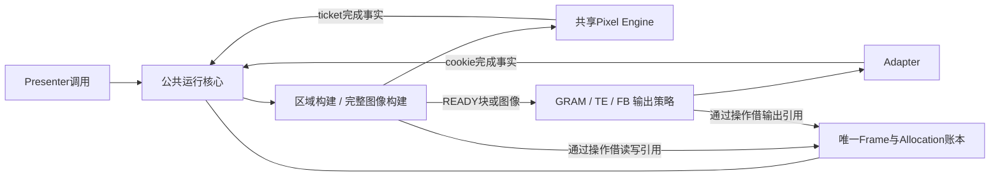
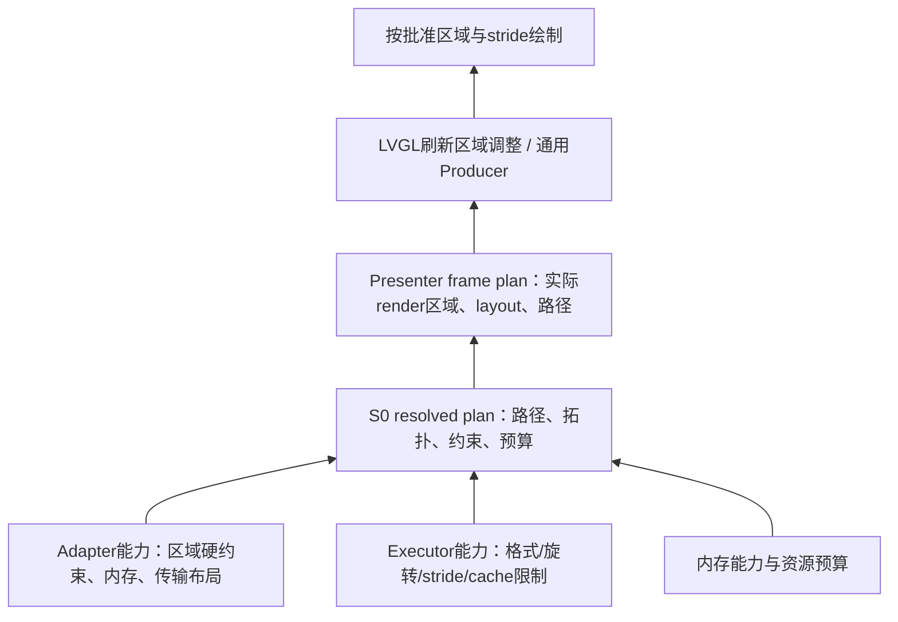

# P3：架构决策、接口契约与实施切片

2026-10-30。状态：用户已授权实施，共同核心/图像构建/新拓扑已接入生产代码。本文保留目标契约；实际完成项和偏差以 PLAN.md 为准。入口：[全局架构](ARCHITECTURE.md)、[模式审计](MIGRATION_AUDIT.md)、[时序推演](OWNERSHIP_SEQUENCES.md)。

## 1. 这次收敛什么

保留统一 Presenter、像素引擎和设备适配边界。将三个完整后端中的帧记录、准入、借用、取消和停止收敛到一个运行核心；完整图像的构建/版本/repair由TE与FB共享；GRAM保持封帧前可发送的区域路径。输出策略只决定发送/切换时机及输出引用，不再实现一整套backend API。

不建立任意拼接的stage表，不为八个模式写八条完整流水线。共享代码必须来自相同语义和相同所有权规则，而非仅仅函数长得相似。以下职责可在少量文件内实现，不要求每格一个文件。

## 2. 决策清单

| ID | 推荐决策 | 兼容与代价 |
| --- | --- | --- |
| D01 | 配置分开tile_count、image_count、tx_capacity、record_capacity | 原buffer_count按旧后端含义在配置入口转换；不得自动猜测它同时代表两种池 |
| D02 | Frame、Image version、Allocation分别标识；一个核心账本拥有实际引用 | receipt不控制扫描分配寿命；不在输出策略复制FREE标志 |
| D03 | 两类构建：区域流、完整图像；完整图像共用覆盖和版本维护 | GRAM无整帧内存负担；TE/FB不各写repair |
| D04 | 三种输出策略：GRAM容量、TE相位、FB切换；共用事务接受性和事件归并 | 策略只保留真实差异：TE时序样本、FB当前/待切换句柄、通道容量 |
| D05 | 保留单/双compose；单compose取消损坏内容后要求全绘 | 不承诺无备用像素时仍可回滚；三compose扩展单列，首轮不默认开放 |
| D06 | 核心配置显式；V1默认/AUTO/scroll协商在兼容配置入口实现 | 核心不调用V1；旧接口不是二进制兼容。AUTO解析输出必须可查询 |
| D07 | TE无安全准入不发送，超时不自动free-running | 有意改变V1超时退化；普通GRAM可显式选择，但不自动切换 |
| D08 | 首轮保留DIRECT的有效旧内容和未声明区域恢复语义 | 先共享正确实现，再按版本减少冗余；不以性能优化名义降低契约 |
| D09 | seal接受构建结束，但不等于像素READY；READY必须等copy/repair/convert完成 | 将生产者封帧与输出就绪分开，避免异步路径以ESP_OK冒充已可发送 |
| D10 | sender和owner使用同一推进函数；一次推进有明确工作上限 | 不在短锁内做整图repair；CPU同步接口仍允许显式阻塞执行 |
| D11 | PARTIAL在tile写入时直接变换到物理图像；FULL/DIRECT按构建并发配置逻辑画布 | 不按物理FB数量复制逻辑全屏池，见第13节 |
| D12 | 有界版本damage history驱动repair；实际coverage独立且精确 | history可保守扩大，coverage绝不能虚假扩大；见第14节 |
| D13 | adapter/executor能力反馈到resolved plan，再反馈producer帧计划 | 区分硬件硬约束、内存约束和可选加速偏好；见第15节 |

## 3. 配置及创建契约

以下是概念字段，不是已发布C ABI：

```text
output: REGION_IO | TE_IO | SCANOUT
render: PARTIAL | FULL | DIRECT
resources:
  tile_count, tile_rows
  image_count
  tx_capacity, record_capacity
  draw_memory, image_memory, tx_memory
execution:
  pixel_executor, async_copy, cooperative_or_worker
content:
  format, draw_order, physical_order, rotation
policy:
  timeout, explicit_active_scanout_writes, te_timing_model
```

创建分两步：resolve/validate返回不可变的resolved plan与内存需求；create分配并attach。query计划不能访问硬件或改变状态。实际平台capability必须由适配器描述并验证，不靠panel类型推断PSRAM可读。

FULL/DIRECT通常无tile池；PARTIAL tile_count独立于image_count。REGION_IO允许image_count=0；TE允许1/2；SCANOUT允许1/2/3，单FB要求明确许可。无效/不支持组合在attach之前拒绝；分配失败按逆序清理，不遗留事件注册。

内存计划同时包含逻辑池、物理池、转换暂存、coverage、事件/记录、LVGL源及线程栈。若选择staging，返回其内存与传输开销，不静默假设零拷贝。

## 4. 最小职责和接口

| 层 | 操作概念 | 可写状态 | 不允许的行为 |
| --- | --- | --- | --- |
| Presenter | resolve、begin/acquire/submit/seal、query/wait、reconfigure | 调用方绑定、参数翻译、观察句柄 | 再建一套硬件pending/缓冲池 |
| 公共核心 | begin、lease、consume、seal、cancel、service、stop | frame、事务、所有权账本、deadline/fault | 在输出回调里重入驱动 |
| 图像构建 | prepare、accept_region、finish、progress | coverage、内容版本、copy依赖、转换进度 | 自己判定扫描已退役或释放驱动FB |
| 输出策略 | admission、submitted、completion_facts | TE时序/FB扫描关系/通道策略 | 独立receipt池、独立取消/停止实现 |
| Pixel Engine | execute/submit、query、drain | 执行ticket和执行器资源 | 自行释放核心拥有的像素分配 |
| Adapter | attach、submit、quiesce、capabilities | 驱动cookie关联和回调源状态 | raw VSYNC直接冒充可重写 |

核心和构建器通过handle及具名操作更新账本，不对外暴露可随意修改的frame结构。分配器与所有权不是两套池：分配元数据在同一资源记录内，外部缓冲只借用不free。



## 5. 帧操作精确语义

| 操作 | 成功 | 可重试失败/超时 | 接受后的错误 |
| --- | --- | --- | --- |
| begin | 原子保留frame record及必要构建资源 | 不发布新frame，不改变前帧 | 不适用 |
| acquire | 返回唯一可写lease；需要的prefill已完成 | 不授写权限；保留构建上下文 | 已接受prefill失败进入fault |
| submit_region | 消费lease，核心接管像素访问 | 未接受时保留lease，不重复提交已接受copy | 通过frame结果报告并排空 |
| seal | 关闭producer写入，保留结果记录；可能仍在copy/repair | 仍有lease等前置条件不满足则保持OPEN | 异步构建失败终结frame/依赖链 |
| cancel | 未封帧构建排空，发布取消记录 | 保留CANCELING，允许重试 | 已更新面板/单compose像素不能回滚 |
| wait | 达到指定完成点或得到明确失败状态 | 只结束本次等待 | fault不等于硬件访问已经结束 |
| stop | QUIESCENT：无硬件/copy访问和未来回调 | 保留closing实例及资源 | 可安全停止的故障实例仍保留诊断 |

seal前能够同步证明的不完整覆盖应拒绝且允许补写；若成功seal后才发现异步执行失败，不重新开放frame。seal与READY的区分必须进入Host断言。

对GRAM，frame完成要求sealed且所有块的已接受操作排空；已发送区域无法通过cancel恢复。对完整图像，封闭版本在READY之前不能作为下一帧可读基线。

## 6. 四类完成事实不能合并

1. Producer源可复用：如LVGL源已复制完，可以flush_ready。
2. Copy/传输读取结束：相应C/T引用结束。
3. 新FB激活：frame可报告显示确认，但当前FB仍持扫描引用。
4. 旧FB退役：旧allocation可在其他引用也归零后再借出。

现有source_released字段容易被误读为第4项；首轮保留已有外部行为并明确其scope，内部禁止用它直接推导allocation可写。是否在公开API进一步改名在review决定，不能静默改变已有wait语义。

失败的结果可先被记录，terminal只有在该操作不会继续访问其所借资源、或按明确定义的FB长期扫描契约完成后才能发布。全局fault不代替complete/quiesce。

## 7. 早到回调与锁

```text
gate下登记事务cookie和读取引用
  → 不持ISR使用的短锁调用adapter.submit
  → ISR可能先写事务完成槽并唤醒
  → submit返回接受性
  → 核心归并接受性与完成事实
  → 只释放一次引用/只发布一次结果
```

事务槽在submit前保留，槽满先背压；重复cookie完成是协议异常，不二次减引用。适配器调用上层前放开自身短锁。等待释放gate，醒后重查权威事实；总deadline不重置。

TE边沿不使用事务完成槽。测量ring满必须标记测量代际失效，不丢边沿后继续宣称相位已证明。slot和ring大小随资源计划计算并设置上限；禁止ISR动态扩容。

## 8. TE接口与待证明的平台条件

策略输入：当前单调时间、图像READY时刻、带极性的边沿样本、配置的blanking极性/扫描模型、发送计划的耗时边界。图像READY晚于某边沿不自动拒绝，关键是当前相位是否合法。

输出固定为：ALLOW（含有效起止时间与测量代际）、WAIT（最早重试时刻或边沿条件）、UNPROVEN（资料/样本不足）、UNSUPPORTED（该计划没有已支持的安全模型）。提交前重新核验有效期；调度延迟跨出窗口则继续等待，不沿用旧许可。

快写/慢写沿扫描位置的推导在纯策略中实现，V1算法只是输入。初始传输预算来自保守配置/校准，实测可提高预算而不能仅依据最近一次较快完成立即缩小；任何超预算记录使后续准入重新评估。尚未配置完整扫描模型时只可声明“边沿同步”，不得标为保证无撕裂的模式。

**平台阻塞项不隐藏**：S31 QSPI的PSRAM直读支持、staging分块命令的实际写入轨迹、TE极性对应真实扫描阶段需要核实。若staging产生长间隙，不能把全帧平均带宽代入匀速写头模型。此问题可阻止TE安全模式上线，但不要求在其他后端塞特例。

## 9. 兼容入口

- V1公开模式和默认值通过独立解析入口映射，保持IO te_enabled选择与FB默认TRIPLE_PARTIAL的可追踪行为。
- V2现有DEFAULT配置保持显式含义；不把新的兼容默认反灌给现有调用方。
- V1 PARTITION scroll拒绝；surface scroll转全绘；damage对齐扩展在绘制之前返回producer。
- 非法模式、无足够外部FB、相互重叠缓冲或不可DMA的内存应明确报错。
- 不做V1二进制ABI兼容；generation、tracking、重绑行为以审计条目做源迁移测试。

## 10. 实施切片：每片必须删除重复职责

| 切片 | 迁移内容 | 必须移除/禁止 | 验收门槛 |
| --- | --- | --- | --- |
| S0 | resolved config、旋转拓扑、能力反馈与资源预算，旧配置翻译 | 不新建后端状态机；不改变发送 | M01～M11配置正/负向、预算计算、默认值对照 |
| S1 | 核心frame/transaction/lease操作，GRAM作为首个接入者 | GRAM重复record/fault/cancel/生命周期权威状态 | GRAM、records、presenter、lcd_spi及异步失败/早到完成 |
| S2 | 完整图像构建器、精确coverage、有界版本差异与repair | 不另建TE版/FB版repair；先用模拟输出独立验证 | FULL/DIRECT/PARTIAL、单/双图像、延迟copy和失败依赖 |
| S3 | TE单/双compose与相位策略接入 | 旧单活动帧composer权威状态、固定窗口唯一假设 | TE全模式Host＋内存/扫描模型证明；S31针对性上板 |
| S4 | FB单/双/三缓冲接入共享构建和核心 | FB重复record/cancel/repair状态；保留真实scanout关系 | 三缓冲真实占用、增量版本、外部FB；S3/P4上板 |
| S5 | Presenter/LVGL/reconfigure贯通，清理旧分发 | 旧后端整套生命周期表；零拷贝渲染分支不得绕过lease | 真实LVGL、旋转、tracking、worker、所有A01～A06 |
| S6 | 硬件加速/内存路径和性能 | 不用CPU回退掩盖配置为硬件但未准入 | P4加速器对照、QSPI完整TE、长时压力和带宽统计 |

迁移期允许不同输出暂时采用旧/新实现，但一个实例只能选一个权威核心；不能每次调用同时镜像修改新旧状态。每片独立提交/可回退，adapter和Pixel Engine公共契约尽量稳定。尚未迁移的输出明确标记，不能声称全局已经统一。

若S2证明共用构建器需要依赖TE/FB私有状态，停下来修正边界，不通过额外回调层继续拼装。

## 11. Host与板测要求

| 时序 | 必须断言的事实 | 实板观测 |
| --- | --- | --- |
| GRAM多tile | 源被DMA借读时不能重绘，后块不超车 | tile地址/cookie/时间戳及画面 |
| TE双compose | DMA读B同时copy读B/写A，A未READY不得发送 | compose地址、build/tx重叠、TE波形、整屏内容 |
| FB三缓冲 | A扫描+B待切换+C构建，第四次begin背压 | 三个真实地址和安全退役事件 |
| 异步seal | 返回seal成功但READY=false，完成前绝不提交 | build/ready/submit时间顺序 |
| uncertain/stop | fault之后仍保留引用，quiesce成功才归还 | stop重试、heap和回调计数；异常注入以Host为主 |
| LVGL复用 | flush_ready后立即改源不改变输出借读像素 | 真实动画与颜色图案，不只看静态首帧 |

S3/P4/S31以MAC重识别，不固定端口号。板测是用户已授权的后续工作；到对应切片立即做针对性验收，不只最后才检查。但目前没有新实现需要重刷，设计文档不能通过重刷旧固件得到验证。

## 12. Review检查表与剩余阻塞

- [ ] D01～D13是否接受；特别是DIRECT防御恢复、AUTO兼容入口及单compose取消语义。
- [ ] 公共核心、构建器、策略是否各只有一份权威状态；无第三套“管理器”复制状态。
- [ ] S0～S6每片都覆盖完整模式组合和失败路径，不按文件数量判断完成。
- [ ] TE平台扫描与内存路径证据补齐后，才承诺安全相位模式。
- [ ] 扩展项（如三compose、更多零拷贝）与公开迁移基线分开。

本次交付到设计review。没有改生产API/源码，没有声称新架构Host或硬件通过。旧测试基线记录在PLAN；本轮只验证文档一致性。

## 13. D11：坐标空间与旋转拓扑

### 13.1 统一坐标规则

producer的damage、render areas和lease坐标均为逻辑空间L；adapter区域和完整输出图像均为物理空间P。内部矩形统一半开区间/起点加extent；V1闭区间仅在兼容入口转换。stride是字节，不由宽度或旋转角度隐式推断。

设逻辑尺寸W×H，矩形(x,y,w,h)，顺时针变换：

| 角度 | 物理矩形(x,y,w,h) | 物理尺寸 |
| --- | --- | --- |
| 0° | (x,y,w,h) | W×H |
| 90° | (H-y-h,x,h,w) | H×W |
| 180° | (W-x-w,H-y-h,w,h) | W×H |
| 270° | (y,W-x-w,h,w) | H×W |

一个公共geometry实现同时负责区域变换、约束映射和触摸逆变换。rotation generation变化使旧空间的history失效；禁止让TE、FB各自算一套偏移。

### 13.2 首轮选择的缓冲拓扑

| 路径 | 绘制和转换位置 | 完整逻辑画布数量 | 完整物理图像数量 |
| --- | --- | --- | --- |
| GRAM PARTIAL | L tile → 可选旋转/packing到P传输块 → 面板 | 0 | 0 |
| TE/FB PARTIAL | L tile → 融合旋转/字节序copy → P候选图像 | **0，即使90/270°** | TE为1/2；FB为1/2/3 |
| FULL/DIRECT、0°且layout兼容 | producer直接借P候选surface，或由绑定复制 | 0个额外逻辑画布 | 按输出池配置 |
| FULL/DIRECT、非0°或layout不兼容 | producer绘制L连续画布 → 转换到P候选图像 | 按仍需被读取的逻辑构建数量配置，**默认1** | 按输出池配置，不一一绑定L池 |

PARTIAL的coverage和history在P空间记录。repair也是P到P复制，不再执行整屏CONVERT。一个tile的转换成功才发布对应coverage；异步失败不能算覆盖。

FULL默认整帧转换一次。DIRECT绘制前必须具备有效L旧内容；向P输出可只转换实际有效更新区域，同时按P版本history修复旧物理图像。首帧/失效版本转为完整转换。首轮允许正确但较慢的DIRECT完整转换回退，须记录理由与字节数，不能把它标成局部优化已实现。

### 13.3 一块L画布的复用边界

L不是封帧后立即可复用：所有L→P copy读引用结束、P图像READY，才可授下一次L写lease。P随后处于READY/T/S不继续借用L，因此三物理FB并不要求三逻辑画布。

默认单producer、一个L画布时，下一次begin/acquire可能等待前次转换，属于明确吞吐取舍。若配置更多构建并发，则L池容量至少覆盖同时被producer写或转换读的数量；不能只按OPEN frame数计算。每块L保留自己的内容版本；DIRECT取得旧L时须通过逻辑history修复，或从最新P基线逆变换建立L，相关读引用必须登记。

DIRECT前一帧未声明区域可能被修改：保留D08防御恢复时，必须先修复这些区域再把L当完整有效版本，不能靠历史版本号忽略未知写入。该契约可能导致全屏恢复；不能同时宣称“允许任意裸写恢复”和“每帧只拷几像素”。FULL下一帧全绘不依赖旧L。

### 13.4 内存与失败条件

1024×600 RGB565每张为1,228,800B=1200KiB。三物理FB的旋转PARTIAL不新增逻辑全屏池；旋转FULL/DIRECT默认额外一张1200KiB，较每物理slot配一张节约2,457,600B=2400KiB=2.34375MiB，尚未计对齐和绑定源。

LVGL独立源、转换目标、零拷贝安全备用buffer仍分别计入预算，不允许因核心L池只有1就漏算绑定内存。若硬件执行器不能直接实现tile→P旋转，优先CPU同拓扑回退；若用户要求硬件且无可行路径，create/plan拒绝。禁止运行时偷偷分配完整L池改变资源承诺。

## 14. D12：版本差异与实际coverage分离

### 14.1 三种信息，不用一个位图代替

- `content_version`：allocation中完整有效图像版本；部分写入或失败使它成为候选/无效，不能提前提升版本。
- `damage_history`：有界版本链，每条记录version、parent、generation及保守dirty区域。用于回答某个旧buffer落后了哪些内容。
- `write_coverage`：本次确实成功写入的精确区域。用于首帧完整性和repair保护，不是producer的未验证提示。

history统一以P空间存储；L画布复用需要同代际逆映射。只有图像构建成功成为READY，才发布可作为基线的完整版本；输出失败依赖链按核心故障契约停止，不伪装成已显示。

### 14.2 修补集合

候选buffer的完整旧版本为k，最新有序基线为b，本帧已实际覆盖区域为W：

```text
U = union(damage[k+1], ..., damage[b])
R = U minus W
```

在候选未被未知写污染、历史完整且同generation时，从基线b向候选复制R即可；不再复制“全屏减去本帧脏区”。首帧或内容未知时U=全屏。P空间repair不增加一次旋转。

例：buffer为n-2，n-1和n各变更一个光标矩形，当前帧更新第三个区域。只需修补前两次变更中未被本帧覆盖的部分；history必须包括移动物体的新旧位置，不能只记新位置。基线读引用保持到repair完成。

该公式不能处理DIRECT未声明的任意裸写：这类未知污染区域必须额外恢复，最保守为全屏减W。其代价独立统计，不用history优化掩盖契约本身的写放大。

### 14.3 有界区域表示与溢出策略

首轮history使用有界矩形列表/环，复用并验证区域并、差、裁剪规则。容量由S0资源计划给出，不随运行无限增长。history可把多个区域合并成包围矩形，最坏降为FULL_DIRTY；这只多复制，不漏更新。history截断、代际变化、版本缺口均令该旧buffer走full repair，不强留无限历史或所有旧图像。

coverage使用精确矩形/行段集合；只允许无空洞的精确合并。容量不足时转换到S0预留的精确bitset，或在接受额外region之前返回背压/资源错误；**绝不能扩大为包围矩形后宣称其中像素已绘制**。单构建coverage在READY后即可回收，长期历史不保留每帧位图；同时存在多个尚未完成构建时分别预算。

若R的矩形差集发生碎片溢出：

1. 绘制前可整帧prefill，然后开始更新；
2. 绘制后必须通过精确W的行段/位图流式复制其补集，保护已经写好的像素；
3. 无安全执行scratch时返回明确错误并保留引用，不能直接整屏copy覆盖本帧新内容。

所有区域算法容量、乘法溢出、半开边界和结果不变式均纳入Host独立参考实现对照。V1的dirty工具可作为迁移候选，不直接以旧代码存在作为正确证明。

### 14.4 必须输出的计量

每帧记录producer字节、tile变换字节、history repair字节、DIRECT防御恢复字节、完整转换字节，以及history缺口/溢出回退原因。P4光标场景验收要断言历史完整的PARTIAL复用不产生整屏补集copy；最终像素正确不足以证明优化完成。

## 15. D13：能力反馈、帧计划与上游协商



### 15.1 约束分类

| 类别 | 示例 | 处理位置 |
| --- | --- | --- |
| 输出区域硬约束 | QSPI列起点/宽度2或4像素对齐 | 映射回L，在绘制前协商或由完整图像供给扩大区域 |
| 内存安全硬约束 | base alignment、stride、DMA可达、cache line独占、容量/padding | 分配/布局/staging，不能单靠扩大脏区解决 |
| 执行器限制 | PPA格式/旋转组合、DMA2D宽度与stride | S0选择可行执行器；每帧plan选择路径 |
| 优化偏好 | 加速器更适合对齐大块 | 可选择扩大render或CPU，不自动上升为面板硬要求 |

单纯将所有alignment求max不正确：要分清起点、extent、stride和原点偏移。兼容的模约束可用受溢出检查的LCM/同余规则合并；不兼容时选择其他路径或拒绝。90/270°会交换轴且带坐标平移，必须使用L↔P几何变换而非仅交换x/y对齐值。

### 15.2 接口信息与时序

`resolved plan`至少包含：logical/physical layout、origin/extent约束、stride/base/padding约束、tile容量与拆分规则、memory topology、选定executor及允许的fallback、硬件约束来源、plan generation。

每帧必须在producer写入之前完成：

```text
request damage(L)
 → 映射到P并满足输出硬约束
 → 选择构建/传输路径及可行布局
 → 映射所需render区域回L，协商必要全绘
 → 返回render_areas / stride / capacity / plan token
 → acquire → draw → submit按token与区域核对
```

纯配置resolve不依赖实际分配地址，create负责验证分配后的地址能力；每帧region plan再检查区域约束。三层检查不能互相省略。submit继续防御性校验，但正常支持路径不能首次在submit才发现不可满足的硬约束。

GRAM无完整基线，扩大传输区域所需像素必须先由producer绘制，不能发送未初始化padding。TE/FB有完整有效P图像时，传输区域扩展可从图像中读取，但这不意味着允许DMA读取allocation之外。

屏幕边缘不能简单“扩展后clip”就假定仍对齐；若物理尺寸与硬约束冲突，需adapter明确的边缘例外、完整合法传输或拒绝。拆band不能破坏行/区域约束；不足一合法band的tile配置在创建时拒绝。

### 15.3 LVGL与fallback

LVGL绑定使用当前支持版本的刷新区域调整钩子，在栅格化前应用frame plan（具体API在实施时核对本地LVGL源码）；不得等flush才扩大读源范围。FULL/DIRECT全画布仍需协商stride、区域与逻辑池寿命。无法在producer绘制前协商的绑定，使用显式足够容量的转换路径或拒绝组合。

CPU回退只可绕过加速器的可选限制，不能绕过面板硬对齐或DMA安全限制。S0可预先允许若干已预算路径；plan在绘制前选择并公开实际路径。硬件已经接受后不得用CPU重写“补救”。运行时capability或rotation变化必须排空并更新generation、重新协商producer。

## 16. 三项数据面决策的验收门槛

| 项 | Host必须证明 | 板测必须观察 |
| --- | --- | --- |
| D11 | 非方形四方向、奇数宽tile、边界位置；旋转PARTIAL额外L全帧分配数为0；FULL/DIRECT单L转换未结束前背压 | S3/P4实际heap/PSRAM峰值、copy字节与画面；S31旋转全屏TE |
| D12 | 旧buffer跨多版本、移动光标新旧位置、history截断/溢出、coverage孔洞、差集碎片、失败/取消/代际重置；不覆盖本帧像素 | P4 1024×600光标/多脏区repair字节和时延；不是只验证最终画面 |
| D13 | 2/4像素输出约束与四方向组合、奇数屏边缘、stride/cache对齐、容量不足、无效plan token、CPU回退不能突破硬约束 | 三板记录resolved plan和实际executor，验证DMA/PSRAM与布局，比较预测/实际资源 |

上述是设计闭环与可证伪的验收条件，不等于已消除所有结构性风险。平台扫描模型、真实DMA可达性和跨核cache行为仍需源码核对与硬件验证。

## 17. 已实现的独立前置切片：Executor插件

用户明确授权后，CPU/PPA/DMA2D可注入接口及旧accel包装已实现。能力/纯probe/execute/destroy接口、公共fallback选择与逐调用选择报告用于后续S0；SoC宏只留在硬件插件边界。无动态加载、全局注册表或新增worker。get_caps不是完整S0规划，probe仍须检查真实地址。

25/25普通Host及ASan/UBSan、S3/P4离线编译通过；P4实际32例像素对照通过，详见README和板测记录。该切片未改变GRAM/TE/FB生命周期或缓冲拓扑，也不意味着S0～S6整体完成。


## 本轮实现映射与明确偏差

公共 frame core、allocation 引用、transaction 归并、共享 image builder、TE 双池重叠、FB 旋转池和 LVGL 协商已落地。history 当前固定 8 代、每代 32 矩形，coverage 直接预留精确 bitset；未另建矩形 coverage 再溢出切换的第二种表示。固定容量已计入 metadata 预算。

后端仍负责自身 lease/copy/输出阶段推进；共同核心收敛了帧与故障权威状态，但尚未变成本文目标中“完全不实现 backend API 的三个薄策略”。此次没有用新增 stage 表掩盖这项差异。进一步合并 API 调度层仍是目标差异；这次保留可独立验证的后端执行阶段，不将公共语义收敛夸大为所有接口已经合一。

外部 DMA 长度约束已上推到 output caps：完整图像先校验总字节数，GRAM 在绘制前保守扩大物理宽度，使各 band 的紧凑传输长度合法；旋转反向拆 band 的宽高同时满足位置/长度对齐公倍数。
