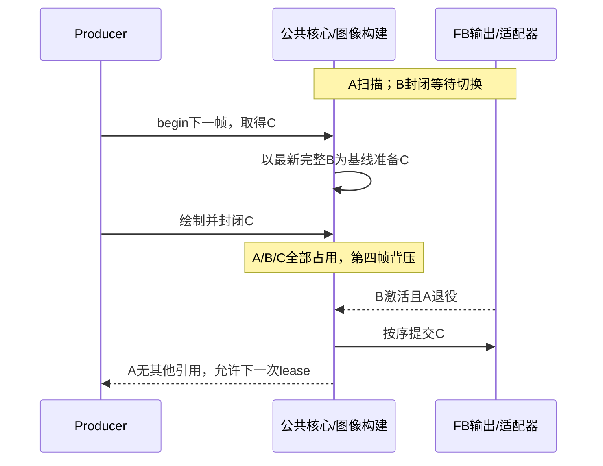

# P2：所有权、时序与内存推演

日期：2026-10-30。状态：第一版待 review；这里是目标契约，不是现有实现说明。依据 [迁移审计](MIGRATION_AUDIT.md)；架构入口 [ARCHITECTURE.md](ARCHITECTURE.md)。

## 1. 三种身份及权威状态

| 对象 | 含义 | 谁维护 | 结束不等于什么 |
| --- | --- | --- | --- |
| Frame | 一次生产请求及其结果/依赖 | 公共运行核心 | receipt终态不等于像素分配可释放 |
| Image version | 一张完整图像的内容版本、覆盖、基线依赖 | 图像构建 | 成为最新基线不等于已显示 |
| Allocation | 实际地址、容量、内存能力与读写引用 | 单一资源账本 | 一次DMA完成不等于没有基线或扫描引用 |

图像对象不再复制一份“是否FREE”。只有资源账本授权写lease；输出策略只能报告/请求增减输出引用。Frame与Image记录通过handle关联，引用不靠receipt寿命维持。

记号：W=独占写lease；C=copy读引用；T=传输读引用；S=扫描/待切换读引用；B=基线保留引用。C/T/S/B可重叠，W不能与别人的读引用重叠。同一图像局部写与其他区域读不作为第一版优化，先用整allocation排他规则。

单FB扫描中写是显式例外，仅在允许撕裂的配置下开放，禁止将该例外传播到多FB或TE模式。

## 2. GRAM 多tile，封帧前可发送

| 步骤 | tile0 | tile1 | Frame与推进 |
| --- | --- | --- | --- |
| 1 | producer持W绘制 | FREE | begin保留frame record |
| 2 | 转换任务持源C；若另有目标则持目标W | producer持W绘制 | submit消费lease但不表示源可复用 |
| 3 | 转换完成后发送源持T | copy/READY | 输出按顺序且通道容量足够才提交 |
| 4 | DMA完成移除T，无其他引用才FREE | 可发送 | ISR记完成；service回收并唤醒 |
| 5 | 所有tile完成 | 所有tile完成 | seal且pending归零才终结frame |

可在第3步之前或之后seal，但seal不等待可见显示。确定拒收保留就绪块和顺序；不确定接受继续保留源。取消未封闭frame只停止后续生产并排空已接受访问，不能撤销面板已更新区域。

## 3. TE 单compose

1. A没有输出读引用时授予W；持久图像中未修改区域可保留，但首次必须全绘。
2. tile合成期间A不可发送；copy排空和覆盖检查完成后移除W，封闭版本n。
3. 策略算出合法相位才给A加T并提交；传输期间不能开始改A。
4. 确定拒收移除暂记T，保留不可变n重试；不确定接受继续持T，禁止复用。
5. 完成后移除T；后续可从A的持久内容更新n+1。
6. 构建取消/失败可能已经改写A：排空copy后标记内容无效，下一帧要求全绘。不能声称还保留成功帧n-1，也不能将未完成候选作为基线。

低内存单compose不会拥有和双compose完全相同的回滚能力；这个差异必须由caps和调用契约表达。

## 4. TE 双compose：发送与下一帧构建重叠

设A是旧完整图像n-1，B已构建版本n。不是将A、B固定命名为baseline/candidate终身不换。

| 步骤 | A | B | 版本与依赖 |
| --- | --- | --- | --- |
| 1 | 旧基线B引用 | 构建W，必要时读A的C | n的覆盖/repair尚未完成 |
| 2 | n不再依赖A的读取，释放A旧基线引用 | 封闭n，持B引用；获得T后发送 | 最新有序完整图像变为n |
| 3 | 获W用于n+1 | 同时持T、B，repair时再持C | 可以读B向A预填/补齐，禁止写B |
| 4 | n+1的copy/覆盖完成，封闭READY | 仍在传输n | n+1显式依赖n；不得越过n提交 |
| 5 | 通道空闲并到合法相位后发送n+1 | n完成、相关读取结束后可复用 | 只有真实引用全部结束才重新授W |

这里允许失败前已开始构建依赖图像，但不允许继续发送失败依赖链。n在接受后失败：锁定输出，排空所有对A/B访问，n+1明确失败；实例保持fault直至已定义的重建流程。确定拒收n仍可重试，n+1不得超车。

先形成可读基线再释放旧基线；不为了凑两张buffer提前丢失仍被copy读取的图像。第三compose属于扩展，使用相同规则但不列入V1公开迁移必需项。

## 5. FB 双/三缓冲

双FB：A扫描持S，B构建持W。FULL直接完整绘制；PARTIAL补齐到完整图像；DIRECT在producer读旧像素之前准备所需旧内容。B封闭后可等待切换；确认B激活并证明A退役后，A才可能可写。B的当前扫描占用不会因为receipt释放而消失。

三FB：

对PARTIAL/DIRECT，C必须继承B而非落后的A。若B失败，则C不能提交。初始驱动FB也必须先登记S；不能在第一帧前默认所有外部buffer可写。

单FB：允许S与显式写权限并存，只保证访问边界，不保证无撕裂；取消也不能恢复已可见像素。生命周期测试必须区分它和双/三FB。

## 6. FULL、DIRECT、PARTIAL 的内容准备

| 契约 | 绘制前 | 封帧前 | 不应发生 |
| --- | --- | --- | --- |
| FULL | 无须复制旧图像；需要可写完整surface | 验证全覆盖，必要转换结束 | 无理由整帧prefill |
| DIRECT | 保证producer需要读的旧内容有效 | 依据已审的可写范围契约处理未声明区域 | 为省copy删除旧内容准备，造成blend错误 |
| PARTIAL | producer绘制tile；candidate可延后补齐 | 实际更新区域＋基线补齐构成完整图像 | 更新前frame未成功却把缺失区域当已有效 |

DIRECT究竟允许调用方写哪些区域、是否防御“未声明但已写”的像素，是D08待决策项：保留V2防御恢复会增加带宽；改成严格lease区域约束是公共契约改变，不能仅以性能优化名义删除。先确定语义，再按版本历史减少冗余拷贝。

旋转：逻辑图像与物理输出surface可能不同。图像构建建立转换依赖，输出仅接收正确物理格式的READY图像；不能让每种输出重写旋转状态机。

## 7. 统一接受性、取消与停止

| 事件 | 必须保留 | 允许动作 |
| --- | --- | --- |
| begin等待超时 | 前序已封闭frame、所有读引用 | 返回超时，不产生新的半个frame |
| 明确拒收且无完成 | READY源、内容版本 | 撤销临时输出占用，稍后按策略重试 |
| submit内早到完成 | 临时已登记的cookie/源引用 | 先记事实，submit返回后统一归并，禁止重复释放 |
| 拒收返回却有完成事实 | 源和冲突证据 | 作为协议异常，保守保留直到证明访问结束；不能当普通拒收 |
| 不确定接受/已接受失败 | 硬件可能访问的源 | sticky fault、终结依赖帧；complete或quiesce前不得释放 |
| 构建取消 | copy正在读取的tile/基线、正在写的candidate | 排空后发布取消；不撤销已封帧输出 |
| stop超时 | 实例、回调上下文、worker和所有存活引用 | 后续重试；不能伪造完成释放资源 |

停止顺序建议：设置closing拒新生产 → 通知并join发送worker（不能持其所需gate等待）→ 排空copy worker → 停止/排空外部TE事件源 → 输出quiesce并等待回调退出 → 回收引用/记录 → destroy。

具体外部事件源由谁拥有必须在P3 API中明确；若由调用方拥有，提供可检验的停止前置条件，而不是假设panel.quiesce包含TE GPIO。quiesce成功但回调未排空时记录source_stopped，重试只等排空，不重复delete panel。

## 8. 任务、锁和事件建议

- owner与可选sender通过同一gate串行推进任务状态；等待时释放gate、醒后重查事实，并共享入口deadline。
- ISR用短锁发布完成事实；不分配、不repair、不调用submit、不拿任务mutex。
- adapter在调用上层回调前释放自己的锁，避免adapter锁与公共锁互相嵌套。
- 硬件提交前先登记cookie和借用；不能拿ISR也需要的锁调用会早到回调的驱动。
- 完成事实建议写入有界transaction槽，唤醒允许合并但事实不能丢；槽满在提交前背压。
- TE测量与完成事件不同。若用边沿ring，溢出必须标记时序样本失效并重新建立窗口，不能丢掉极性后继续宣称安全。相位策略采样/溢出规则待P3定稿。
- token包含实例/代际约束；外部事件producer销毁前退出，不能靠token检查解决回调上下文已释放。

以上待时序测试验证，不声称完成形式化并发证明。

## 9. 内存预算：先看真实分辨率

单位KiB=1024B；以下为紧凑像素净值，不含堆元数据、任务栈、驱动bounce、对齐扩张和渲染器自身buffer。

| 项目 | 480×480 RGB565 | 1024×600 RGB565 |
| --- | ---: | ---: |
| 一张完整图像 | 450 KiB | 1200 KiB |
| 两张完整图像 | 900 KiB | 2400 KiB |
| 三张完整图像 | 1350 KiB | 3600 KiB |
| 16行tile一块 | 15 KiB | 32 KiB |
| 双tile | 30 KiB | 64 KiB |
| 每像素1bit coverage一份 | 28.125 KiB | 75 KiB |
| RGB888一张完整图像 | 675 KiB | 1800 KiB |

若双compose＋双16行tile＋一份coverage，RGB565净额分别为958.125KiB和2539KiB；若同时构建多个frame需额外coverage。旧实现旋转额外逻辑池每张再加450/1200KiB；新拓扑PARTIAL不增加逻辑全屏池，FULL/DIRECT默认只增加一张（详见DESIGN_REVIEW第13节）；LVGL独立FULL源也按完整图像计，零拷贝安全备用buffer不能漏算。

当前V2 TE固定内部双compose，因此不能把分辨率改成480×480就假定适配。必须选择平台真实支持的PSRAM直读或有界DMA staging，并把staging切块与发送间隙算进TE预算。构建能分配PSRAM不等于外设能读它。

40MHz四线、480×480 RGB565纯载荷下界23.04ms，只是带宽下界；窗口合法性仍需扫描模型和实测。稳定耗时均值不足以作为最坏预算，需包含copy、cache、命令和调度间隙。

## 10. P3 前还需定稿

1. D01～D07及D08的明确支持/兼容决策。
2. Frame/Image/Allocation最小接口和唯一写入者，避免新的共享可变大对象。
3. TE测量/准入有效期、预算更新及异常处理的确定算法。
4. 平台内存能力描述与staging路径选择；DMA/扫描驱动证明。
5. 将以上每段时序转为独立Host断言和板测观测量；不只测试最终像素。

本版提供完整讨论路径但不是最终实现规格；P2仍在review前设计阶段，不以写完文档标记所有开放问题已解决。

## 设计收敛入口

推荐决策、接口契约、实施切片及待review检查表见 [DESIGN_REVIEW.md](DESIGN_REVIEW.md)。本文为时序/职责依据；新设计尚未落到生产代码。

## 数据面规则补齐

以 [DESIGN_REVIEW.md](DESIGN_REVIEW.md) 第13～16节为后续设计依据：coverage按尚未完成构建预算并可回收，不按长期输出帧保留；history独立有界；旋转PARTIAL直接写P图像；对齐协商在producer绘制之前完成。DIRECT防御恢复可能仍有全屏成本，不能用damage history假装消除未知写入。
