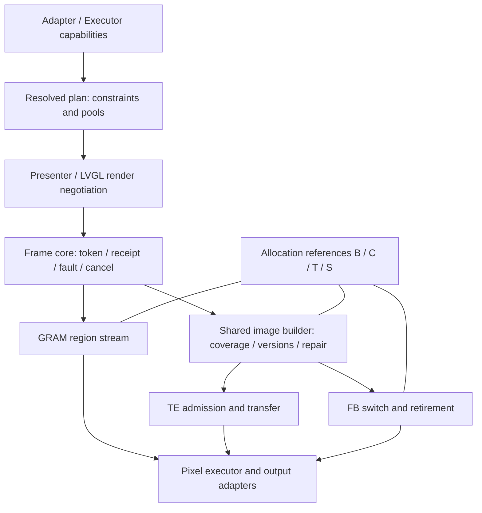

> 当前执行（2026-11-03）：生命周期、符号与私有导出收敛已落地，核心／binding 已并入 `esp_display_present`／`esp_lv_present`；Host、三目标离线与 GSP 链接通过，最终记录见新组件 MIGRATION_STATUS.md。旧目录仅用于历史记录，不再是生产组件。详见 [执行记录](TRANSITION_DESIGN.md#13-执行记录两组件候选2026-11-03)。未上板、未发布、未提交。

## 下一轮：旧契约与 V2 状态收敛（2026-11-03）

设计与逐项验收以 [TRANSITION_DESIGN.md](TRANSITION_DESIGN.md) 为准。下列步骤已完成至本地 T3 验收；T4 上板尚未执行。

1. T0：核对字段读写与契约，补基线缺口。
2. T1：先收敛撤销／关闭；核心管理执行事实，门面保留旧句柄及应用意图。
3. T2：再拆 poll 的时间线投影、receipt 回收、tracking 水位；额外两个原始 VSYNC 语义不变。
4. N0／N1：先盘点公开／私有符号，再独立迁移为正式 `esp_*` 命名；`pv2_image_repaired` 作为私有操作改名为 `present_image_mark_repaired`。兼容、导出和目录边界见设计第 11 节。
5. N2：N1 完成后将核心和 binding 分别合并到 `esp_display_present`、`esp_lv_present`，同步构建与交付依赖。
6. T3：全量 Host／sanitizer、默认入口离线构建与 GSP／LVGL 链接评审。
7. T4：三板候选短回归后收口；不以历史板测代替。

各阶段独立评审：旧应用 API 保持不变；扩展与内部接口命名单独迁移，不增加模式、不夹带性能优化。N0 可提前盘点，N1 在 T2 后执行，N2 随后实施，T3 验收最终候选。生命周期独立复审、命名迁移、组件合并与最终本地验收已完成；实板和发布另行验收。

> 2026-11-03 默认入口已切到 V2，旧实现已移除；当前布局、支持范围及验证见 [DEFAULT_SWITCH.md](DEFAULT_SWITCH.md)。下文旧阶段中的“尚未切换”与 V1 源码路径只用于历史追溯。

> 2026-11-03：完成兼容 TE 非阻塞准入、未封帧 stop／TE 取消收尾、自动单 tile 回退和独立组件交付修复。最新验证与限制见 [review.md](review.md)。

# V2 实施与验收状态

本轮代码、性能和未通过项统一见 [收敛验收记录](test_apps/legacy_compat/RESULTS_CLOSE_20261102.md)。

> 2026-11-02 当前收敛状态见 [V1 兼容状态](V1_COMPATIBILITY_GAPS.md) 与 [收敛计划](CONVERGENCE_PLAN.md)。下面旧日期的数量和限制属于历史切片，不能替代当前门面验收。

更新：2026-10-30。本轮从执行器前置继续推进公共核心、图像构建、TE/FB、Presenter/LVGL 和三板验证。以下是当前代码状态；早期计划及阶段性测试数保存在 [历史计划](PLAN_HISTORY_2026-10-30.md)。

## 实施结果

| 切片 | 已落实到生产代码 | 验收与边界 |
| --- | --- | --- |
| Executor | CPU/PPA/DMA2D 显式注入、纯 probe、能力查询、统一选择层、旧 API 薄包装 | 四种独立插件链接；P4 32 例像素对照 |
| S0 配置规划 | 模式归一化，tile/image/logical/transfer 独立数量，内存类型，旋转拓扑，输出/执行器约束，渲染区域协商，总请求预算 | 不支持的配置在分配/attach 前拒绝；硬件地址仍须执行前 probe |
| S1 生命周期 | 三后端共用 frame/receipt/fault/cancel 核心、接受性/完成归并；allocation 的 B/C/T/S 引用与写权限 | receipt 终态不释放扫描引用；lease 与 copy/输出槽仍由各后端推进 |
| S2 图像构建 | TE/FB 共用精确 coverage、内容版本、8 代/每代 32 矩形 history 和增量 repair | history 溢出退化全图 repair；coverage 不放大；DIRECT 保留防御性修补 |
| S3 TE | 显式单/双 compose，前帧发送与后帧构建重叠，FIFO 输出，边沿重试；线性扫描模型的动态相位准入 | Host 覆盖延迟 DMA、拒收及故障；模型不能自动推断真实面板扫描规律 |
| S4 FB | 接公共核心/构建器，多 tile 独立于 image 数；PARTIAL 边拷边转；FULL/DIRECT 共享一张逻辑画布 | PARTIAL 无额外逻辑全屏池；已扫描图像一直持有 S 引用 |
| S5 Presenter/LVGL | 规划入口、失效区域协商、拆 band、三绘制契约、运行时旋转保留对象树 | `pv2_lvgl_set_rotation()` 排空后重绑；原 tracking 与事件/后台 service 契约保留 |
| S6 验收 | Host/LVGL 29/29、ASan/UBSan 29/29；S3/P4/S31 实板覆盖五模式基线 + 动态四方向旋转、异步 copy、单/双 compose、P4 PPA/DMA2D 硬件加速显示组合及 **S31 480×480 全屏动态相位 TE (`pv2_te_window`)** | 本轮板测详见 RESULTS；S31 全屏慢写相位窗口 `[678, 7308) µs` 内实测提交相位 `[814, 3636] µs`、最大传输 `23852 µs` |

## 当前流水线与职责



共同核心拥有共同语义；后端保留 copy ticket、发送队列和硬件阶段推进。共享 image builder 负责内容/修补规划，执行与等待仍由 TE composer 或 FB 驱动，不是万能 stage 表，也不能将三个后端已变成无状态薄包装作为交付结论。

## 明确拒绝的配置

- 同时使用多张逻辑构建画布（`resources.logical_count > 1`；当前单 producer 只需一张，`pv2_plan_resolve` 直接返回 `ESP_ERR_NOT_SUPPORTED`）。
- 规划器要求非当前紧凑 stride 或非 64B 基址约束的池布局（`pv2_plan_resolve` 直接返回 `ESP_ERR_NOT_SUPPORTED`，不再留 `pending_runtime`）。
- TE 没有可用固定发送预算、也没有合法显式动态时序模型（`pv2_plan_resolve` 直接返回 `ESP_ERR_NOT_SUPPORTED`；不允许超时后自由发送）。
- 注：FB `FULL`/`DIRECT` 的 `draw_order != panel_order` 现已通过单张逻辑构建画布 + 转换阶段支持，不再拒绝。

所有规划通过的配置均具备完整运行时路径（`pending_runtime == 0`）；不支持的组合在 `pv2_plan_resolve()` 阶段直接返回 `ESP_ERR_NOT_SUPPORTED` 或 `ESP_ERR_INVALID_ARG`。旧 `PV2_PLAN_NEEDS_*` 枚举值仅保留头文件兼容。

## 内存与硬件约束

`required_bytes = pixel + coverage + metadata + requested stacks + additional_budget_bytes`。这是框架分配请求及调用方预留，不是测得的整机峰值 heap。驱动、LVGL、分配器和 Host pthread 栈开销需单独预留/测量。

S31 双全屏 TE 不能放入本次剩余约 444 KB 内部 RAM（一张 RGB565 为 460800 B）。测试已使用显式 PSRAM 图像池与 SPI2 PSRAM 直接 DMA；底层 LCD IO 和 adapter 必须同时开启 `psram_dma_direct`。适配器要求 64B 地址/长度及外部 DMA 能力，不隐式分配全屏内部暂存。

动态 TE 模型仅适用于扫描与写入同向、全帧线性时间界限已证明的面板。S31 本轮全屏测试采用标明 UNVERIFIED 的边沿门控，验证传输/生命周期，未验证光学扫描相位。539 µs 高脉冲不能当作完整合法窗口。

## 验收命令

```sh
python3 tools/dev.py test --with-lvgl --build-dir build/host-relocated
ASAN_OPTIONS=detect_leaks=0 python3 tools/dev.py test --with-lvgl --sanitize --build-dir build/sanitize-relocated
# 激活本地 ESP-IDF 后
python3 tools/dev.py idf-build --target esp32s3 --with-lvgl --build-dir build/esp32s3-converged
python3 tools/dev.py idf-build --target esp32p4 --with-lvgl --build-dir build/esp32p4-converged
```

sanitize 关闭泄漏检测；未声称泄漏检测、竞态穷举或真机所有时序通过。测试工程、身份与原始记录见 [板测结果](test_apps/boards/RESULTS.md)。当前重构代码尚未自动提交 Git。

## 驱动扫描边界专项（2026-11-02）

新增独立 [scanout_boundary 工程](test_apps/scanout_boundary/README.md)：仅在隔离构建副本中给 IDF/V2 注入事件记录，生产接口和运行策略不变。记录源读取区间、每次 bounce EOF、FB 完成、VSYNC、链表配置/切换、restart，以及 V2 提交/确认/退休/构建。溢出、截断、watchdog 或关键证据缺失不得判通过。

本轮 Host + LVGL 与 ASan/UBSan + LSan 为 **31/31**（含 C 记录器测试和 Python 分析器测试，后者有 15 个用例）。实板结果与边界以 [专项 RESULTS](test_apps/scanout_boundary/RESULTS.md) 为准，不把单次画面正确当作生命周期证明。

支持范围保持连续 RGB bounce / MIPI；无 bounce 连续/单次 RGB 只观察 IDF，不接入 V2。默认双边界确认的结果不外推到 single_boundary_retire。仍未受控注入丢 EOF / MIPI underrun；MIPI 驱动原生 underrun 仅日志，生产 FAULT 转发/恢复尚无本轮证据。记录器改变时序，也不证明光学显示完成或无撕裂。

## 短期收敛执行入口（2026-11-02）

后续按 [CONVERGENCE_PLAN.md](CONVERGENCE_PLAN.md) 的 C0～C5 顺序执行；契约、平台装配、V1 门面、默认性能和 coverage 内存分开验收。历史 S0～S6 完成状态不代表兼容门面已经实现。实际 V1/GSP 调用面见 [V1_API_AUDIT.json](V1_API_AUDIT.json)。

## C2 基础兼容入口进度（2026-11-02）

21 个 V1 同名入口、旧 LVGL start/stop/frame_count、32/64 位 lease 映射及私有控制桥已接通。资源聚合归入兼容组件，核心不反向依赖 V1。新增 legacy_facade Host 回归与原工程离线准备工具；原默认组件未切换。六种 FB 模式、tracking/generation/scroll、控制任务和实际 LVGL handoff 已有基础 Host 证据。

C2 尚未整体完成：保留 TE/单 FB 等明确拒绝项，逐笔传输 timeout 尚不等价；原工程/GSP 完整验收仍按 [收敛计划](CONVERGENCE_PLAN.md) 继续。C3 新固件板测、C4 常驻 coverage 位图收敛、C5 条件性优化未完成，不计入已有驱动板测。

本轮 C2 基础切片最终结果：Host/LVGL 33/33、ASan/UBSan/LSan 33/33（泄漏检测开启）、legacy_facade 连续 50 次；S3/P4 组件离线 smoke 及三个原示例的 P4 离线链接通过。showcase 使用缓存 GSP 1.9.0，不等同于原 1.5 发布组合。未烧录、未跑分；详情见 [C2 RESULTS](test_apps/legacy_compat/RESULTS.md)。C2 整体仍未验收完成。

## C2 第二轮收敛（2026-11-02）

已按 V1 源码修正帧计划、band 行数对齐、GRAM 水位、tracking 与 fault/handoff 语义；直接链接原纯几何实现进行 Host 差分。逐笔传输期限放在现有 Presenter 提交/事件入口，启用才分配计时记录；记录不拥有像素，不改后端退休规则，也不新增线程。超时只报 FAULT，真实完成仍须排空。

Host/LVGL 与 ASan/UBSan/LSan 均 34/34，三个相关回归各连续 50 次；S3/P4 组件、三个原示例 P4 离线重新链接及格式/补丁检查通过。无烧录、无新跑分。TE 平台模型/内存事实/事件源、单 FB、非方形旧 API 运行时跨轴、实际 GSP 发布组合和 C3～C5 尚未关闭，详见 [最新 RESULTS](test_apps/legacy_compat/RESULTS_C2_CONTRACTS.md)。

C3 P4 原 GSP/LVGL 交接已完成一整批 5 轮及额外第 6 轮，日志零错误；每轮 LVGL 139 帧，未做官方 benchmark。修正并回归了保留 LVGL 绑定但暂停 raster 时的 quiesce 排空。详见 [P4 交接结果](test_apps/legacy_compat/RESULTS_C3_P4_HANDOFF.md)，三板完整 C3 与 C4/C5 仍未关闭。

P4 交接视觉反馈更正：用户报告仅背光亮、无显示。6 轮串口 PASS 仅证明日志层交接，不能标为显示验收通过；C3 保持未通过，需驻留测试固件并同步排查面板输出。详见交接结果的视觉反馈更正。

## 门面的能力超集原则（2026-11-02）

门面以 V1 已成功调用的契约为底线，向上开放已验证的 V2 能力。旧成功调用的逻辑尺寸、像素、所有权和生命周期语义不变；以前失败的配置可以新增支持。PV2_PLAN_V1_DEFAULTS 选择默认模式/池数量，不充当 V1 能力上限。

已移除 GRAM、DIRECT 非零旋转的纯 V1 限制，联动 buffer-count 查询、资源创建、plan 和 set_rotation。初始非方形旋转保持原配置的逻辑宽高，物理输出按角度映射；运行时非方形跨轴仍拒绝，不会静默交换旧调用方的逻辑宽高。GRAM 四方向及同轴运行时二次提交、DIRECT 四方向及同轴二次提交均以真实 V1 几何函数做逐像素 Host 对照。

真实资源限制仍由核心检查：例如 0° 原地字节交换 GRAM 实例不能运行时切换非零角度，失败保留 generation。需旋转的调用方可在创建时指定角度以获得转换路径；本轮不为原来成功的 0° 配置强行增加转换池。TE 平台装配、单 FB、RGB 无 bounce、非方形运行时跨轴等缺口继续明确记录，不冒充超集已全部实现。

本轮仅 Host 与离线编译，不烧录、不改默认示例选择；之前 P4 黑屏/复位观察仍独立待定位。完整结果见 [超集旋转验收](test_apps/legacy_compat/RESULTS_SUPERSET_ROTATION.md)。

V1 取消契约收敛：void cancel 对外立即撤销 frame/lease，内部保留取消排空；下一次 begin 共用准入预算，超时可重试且不提前释放源。独立控制任务只能处理门面已撤销的 producer frame。见 [取消回归](test_apps/legacy_compat/RESULTS_CANCEL_COMPAT.md) 与 [V1 成功路径缺口](V1_COMPATIBILITY_GAPS.md)。本轮不是整体兼容完成，显示黑屏反馈与创建/旋转缺口仍未关闭。
