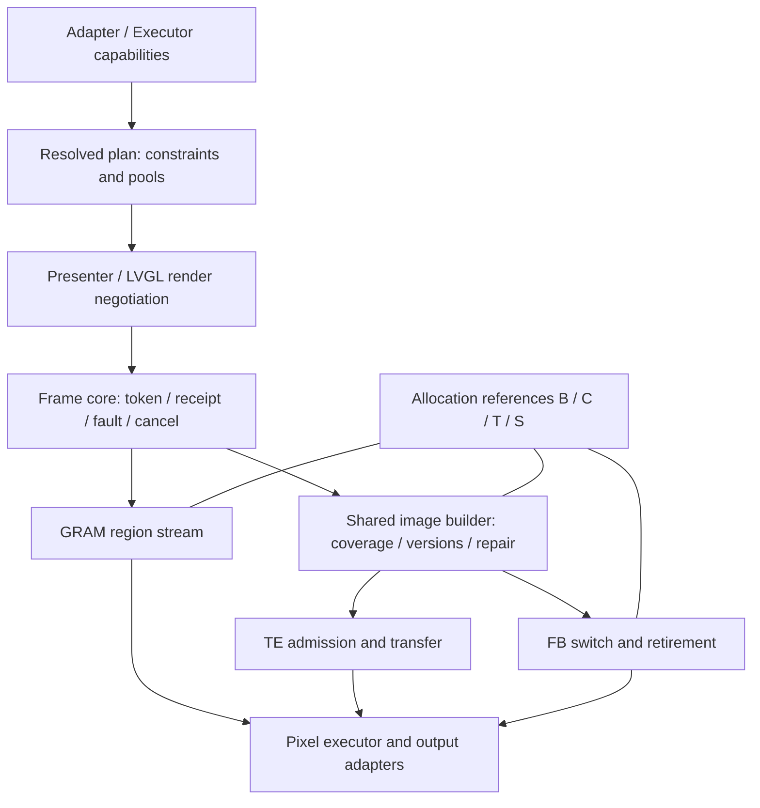

# V2 实施与验收状态

更新：2026-10-30。本轮从执行器前置继续推进公共核心、图像构建、TE/FB、Presenter/LVGL 和三板验证。以下是当前代码状态；早期计划及阶段性测试数保存在 [历史计划](PLAN_HISTORY_2026-10-30.md)。

## 实施结果

| 切片 | 已落实到生产代码 | 验收与边界 |
| --- | --- | --- |
| Executor | CPU/PPA/DMA2D 显式注入、纯 probe、能力查询、统一选择层、旧 API 薄包装 | 四种独立插件链接；P4 32 例像素对照 |
| S0 配置规划 | 模式归一化，tile/image/logical/transfer 独立数量，内存类型，旋转拓扑，输出/执行器约束，渲染区域协商，总请求预算 | 不支持的配置在分配/attach 前拒绝；硬件地址仍须执行前 probe |
| S1 生命周期 | 三后端共用 frame/receipt/fault/cancel 核心、接受性/完成归并；allocation 的 B/C/T/S 引用与写权限 | receipt 终态不释放扫描引用；lease 与 copy/输出槽仍由各后端推进 |
| S2 图像构建 | TE/FB 共用精确 coverage、内容版本、8 代/每代 32 矩形 history 和增量 repair | history 溢出退化全图 repair；coverage 不放大；DIRECT 保留防御性修补 |
| S3 TE | 显式单/双 compose，前帧发送与后帧构建重叠，FIFO 输出，边沿重试；线性扫描模型的动态相位准入 | Host 覆盖延迟 DMA、拒收及故障；模型不能自动推断真实面板扫描规律 |
| S4 FB | 接公共核心/构建器，多 tile 独立于 image 数；PARTIAL 边拷边转；FULL/DIRECT 共享一张逻辑画布 | PARTIAL 无额外逻辑全屏池；已扫描图像一直持有 S 引用 |
| S5 Presenter/LVGL | 规划入口、失效区域协商、拆 band、三绘制契约、运行时旋转保留对象树 | `pv2_lvgl_set_rotation()` 排空后重绑；原 tracking 与事件/后台 service 契约保留 |
| S6 验收 | Host/LVGL 29/29、ASan/UBSan 29/29；S3/P4/S31 实板覆盖五模式基线 + 动态四方向旋转、异步 copy、单/双 compose、P4 PPA/DMA2D 硬件加速显示组合及 **S31 480×480 全屏动态相位 TE (`pv2_te_window`)** | 本轮板测详见 RESULTS；S31 全屏慢写相位窗口 `[678, 7308) µs` 内实测提交相位 `[814, 3636] µs`、最大传输 `23852 µs` |

## 当前流水线与职责



共同核心拥有共同语义；后端保留 copy ticket、发送队列和硬件阶段推进。共享 image builder 负责内容/修补规划，执行与等待仍由 TE composer 或 FB 驱动，不是万能 stage 表，也不能将三个后端已变成无状态薄包装作为交付结论。

## 明确拒绝的配置

- 同时使用多张逻辑构建画布（`resources.logical_count > 1`；当前单 producer 只需一张，`pv2_plan_resolve` 直接返回 `ESP_ERR_NOT_SUPPORTED`）。
- 规划器要求非当前紧凑 stride 或非 64B 基址约束的池布局（`pv2_plan_resolve` 直接返回 `ESP_ERR_NOT_SUPPORTED`，不再留 `pending_runtime`）。
- TE 没有可用固定发送预算、也没有合法显式动态时序模型（`pv2_plan_resolve` 直接返回 `ESP_ERR_NOT_SUPPORTED`；不允许超时后自由发送）。
- 注：FB `FULL`/`DIRECT` 的 `draw_order != panel_order` 现已通过单张逻辑构建画布 + 转换阶段支持，不再拒绝。

所有规划通过的配置均具备完整运行时路径（`pending_runtime == 0`）；不支持的组合在 `pv2_plan_resolve()` 阶段直接返回 `ESP_ERR_NOT_SUPPORTED` 或 `ESP_ERR_INVALID_ARG`。旧 `PV2_PLAN_NEEDS_*` 枚举值仅保留头文件兼容。

## 内存与硬件约束

`required_bytes = pixel + coverage + metadata + requested stacks + additional_budget_bytes`。这是框架分配请求及调用方预留，不是测得的整机峰值 heap。驱动、LVGL、分配器和 Host pthread 栈开销需单独预留/测量。

S31 双全屏 TE 不能放入本次剩余约 444 KB 内部 RAM（一张 RGB565 为 460800 B）。测试已使用显式 PSRAM 图像池与 SPI2 PSRAM 直接 DMA；底层 LCD IO 和 adapter 必须同时开启 `psram_dma_direct`。适配器要求 64B 地址/长度及外部 DMA 能力，不隐式分配全屏内部暂存。

动态 TE 模型仅适用于扫描与写入同向、全帧线性时间界限已证明的面板。S31 本轮全屏测试采用标明 UNVERIFIED 的边沿门控，验证传输/生命周期，未验证光学扫描相位。539 µs 高脉冲不能当作完整合法窗口。

## 验收命令

```sh
python3 tools/dev.py test --with-lvgl --build-dir build/host-relocated
ASAN_OPTIONS=detect_leaks=0 python3 tools/dev.py test --with-lvgl --sanitize --build-dir build/sanitize-relocated
# 激活本地 ESP-IDF 后
python3 tools/dev.py idf-build --target esp32s3 --with-lvgl --build-dir build/esp32s3-converged
python3 tools/dev.py idf-build --target esp32p4 --with-lvgl --build-dir build/esp32p4-converged
```

sanitize 关闭泄漏检测；未声称泄漏检测、竞态穷举或真机所有时序通过。测试工程、身份与原始记录见 [板测结果](test_apps/boards/RESULTS.md)。当前重构代码尚未自动提交 Git。
