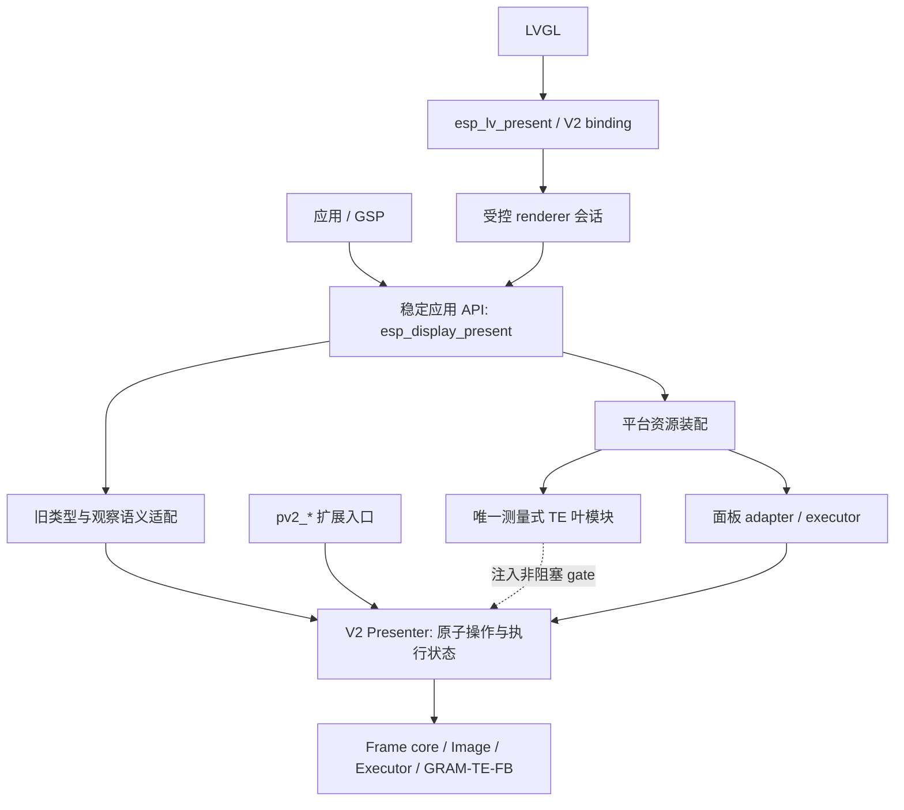
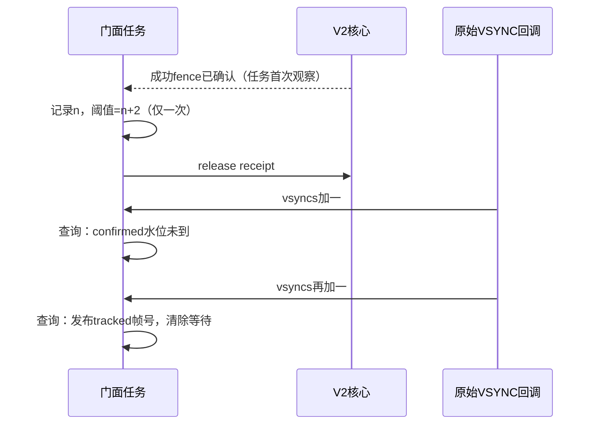

# 旧应用契约与 V2 唯一执行引擎：交接与状态收敛设计

日期：2026-11-03。状态：生命周期、命名与两组件合并已完成本地验收；候选上板未执行。以下历史设计约束继续有效，最新证据以末尾执行记录为准。

本文件规定下一轮状态收敛，不重复实施默认入口切换。当前工作树已经将 `esp_display_present`／`esp_lv_present` 默认入口接到 V2，并移除旧生产实现；该阶段证据见 [DEFAULT_SWITCH.md](DEFAULT_SWITCH.md)。已有 35 项 Host 通过不代表本计划新增验收已完成。

## 1. 决策与范围

应用继续先创建 panel，再一次 `esp_display_presenter_create()`，随后按需执行 begin／acquire／submit／commit，以及 quiesce／stop／delete。资源适配器、执行器、TE 测量与后台推进由平台装配承担，应用不增加初始化步骤。

当前 `pv2_*` 是同一 Presenter 引擎的扩展入口，正式命名将按第 11 节去掉版本前缀；供显式装配 adapter、executor 或调度的集成方使用。它不是第二个运行时实现，也不表示可以绕过门面会话锁并发操作同一实例。

状态收敛阶段 T0～T2 冻结函数名、配置布局、模式、旋转拓扑、后台线程数量和性能策略。独立命名阶段 N0／N1 按第 11 节实施，不与行为修复混合；不重写 frame core、image builder 或 executor，不修改默认支持／拒绝范围。

**唯一生命周期指唯一的执行生命周期。** 门面可以保留旧句柄、应用撤销／关闭请求和显示观察状态，但不能独立判定硬件访问结束、授予写权限或释放在途缓冲。

## 2. 结构与依赖

此图表示职责，不要求新增同名模块或 stage 表。LVGL binding 可通过受控桥接获取同一核心；会话排他和 producer handoff 必须保持。核心不依赖门面类型、旧错误码、旧 generation 或 GPIO 测量实现。

## 3. 字段归属清单

每项实施前，核对全部读写点与调用方；下表是设计约束，不是机械删字段清单。

| 字段／事实 | 权威来源 | 门面保留理由与下一步 |
| --- | --- | --- |
| 核心 frame_active、cancel_pending、pending_frames、first_error | V2 Presenter／后端 | 执行事实，门面不能另作排空或完成判断 |
| 源是否释放、缓冲是否可写、扫描引用是否退休 | 后端及 adapter fence | receipt 是观察证据；拿到 drawbuf 指针不等于取得 lease |
| 门面 active | 应用帧有效性；当前还镜像部分核心状态 | 区分“旧调用方的帧仍有效”和“核心仍在排空”；稳定态约束需列明，不能直接改成查询核心 frame_active |
| 门面 cancel_pending | 应用取消意图由门面记录；排空完成由核心确认 | 初次零预算取消甚至可能未取得核心锁；必须保留未送达／未完成的取消意图，不能只读取核心 canceling |
| lease_id、next_lease、pv2_lease_t | 核心 lease 授予权限；旧 ID 由门面生成 | 保留数值空间映射及过期 ID 校验；成功 submit／逻辑 cancel 后旧 ID 失效 |
| 门面 state | 应用会话关闭／故障语义与核心结果的投影 | CLOSING 可早于核心 closing；区分关闭请求与执行停止，不强迫两者始终相等 |
| timeline.fault_reason | 核心故障或门面识别的旧协议错误 | 保留旧错误分类及锁存规则；取消等待超时、准入背压不凭空产生协议故障 |
| timeline.generation | 门面绑定代 | 创建／成功旋转按既有规则更新；用于拒绝旧 tracking，不进入帧核心 |
| last_submitted_frame | 核心 committed_frames | 观察投影，不能变成新的提交计数器 |
| completed_transfer_frame、completed_present_frame | 核心完成证据加旧成功水位规则 | 核心 completed_frames 包含终态失败；保留故障时不推进成功水位的规则，不直接无条件复制 |
| tracked | 核心 receipt 的门面观察引用 | 终态观察完成后及时释放；不得为两个额外 VSYNC 延长核心 receipt 生命周期 |
| tracked_id、vsyncs、confirm_after、confirmed_present_frame | 核心 fence + 门面原始 VSYNC 观察 | 仅显式 track_display；完整留在门面，见下一节 |
| full_next、render_alignment | 旧请求协商 | 首帧、撤销、旋转全绘规则保留；核心接收本次协商结果 |
| lvgl_bound、producer | renderer 会话／任务绑定 | 保留与核心 rebind 的受控同步；核心 rebind 不代表 LVGL 锁已交接 |
| config、caps、drawbuf | 配置归平台装配；caps／drawbuf 源自核心 | 缓存不构成所有权；创建及旋转后的刷新失败不能留下可用假象 |
| resources、executor、TE、SPI／scanout | 平台装配 | 创建、失败清理、可重试销毁继续留在装配层 |
| gate、events | 同步机制 | 不因字段减少而合并锁；保持任务／ISR 分工和现有锁顺序 |

必要的桥接字段不以行数为标准删除。只有证明其能在同一序列化操作内可靠推导、且不丢失旧请求语义，才能移除镜像。

## 4. confirm_after 契约：已定案，保持不变

依据：[公开 frame_status 定义](../esp_display_present/include/esp_display_present_types.h)、[commit/tracking 契约](../esp_display_present/include/esp_display_present.h)、[门面 framebuffer_tracking 回归](tests/test_legacy_facade.c)。

1. 只有 `track_display=true` 进入额外观察路径；后续 begin 等待该 tracking 结束，或由 cancel_frame_tracking 解除等待。
2. 核心 present_confirmed 表示核心认可的 fence。scanout 默认使用两个 frame_buf_complete；单边界、单 FB 有独立适配规则，不能与原始 VSYNC 混为一谈。
3. 门面第一次任务侧观察到成功 fence 时，记录当前原始 VSYNC 计数 n，建立一次 `confirm_after = saturating_add(n, 2)`。它不是 ISR fence 时刻，因此允许更保守、更晚。
4. 正常路径观察终态后立即释放核心 receipt；仅保留旧帧号和 VSYNC 阈值。若 release 失败，不丢句柄、不重复建立阈值、不提前发布确认，保留错误与重试路径。
5. 两个额外原始 VSYNC 到达后，任务查询或既有 poll 入口可发布 confirmed_present_frame。不能依赖下一次 commit 才发布；不新增等待型查询。
6. cancel_frame_tracking 不确认帧，不改变硬件所有权；清掉匹配的 frame/generation、阈值及相应观察引用。下一帧不能继承阈值。
7. quiesce 仍按 completed_transfer_frame 判断，不等待旧确认水位。未跟踪提交不受该观察路径影响。
8. GRAM 没有该 scanout present_confirmed 证据；旧 completed_present_frame 仍按现有传输完成映射。

**禁止变化：** 将额外两个 VSYNC 加入核心退休条件；延迟 receipt 释放直到阈值；把任务观察起点改为 ISR 精确起点；用原始 VSYNC 回调释放缓冲；在故障或取消后发布成功确认。

## 5. 撤销与关闭交互

### 5.1 两类状态

- 门面应用状态：旧帧／句柄是否还有效、取消请求是否需要重试、是否已请求关闭。
- 核心执行状态：构建是否仍在、访问是否仍在途、取消是否排空、是否已停止。

逻辑撤销后门面可以已无 active frame，而核心仍有 cancel_pending。这是合法桥接，不是状态失配。持有 lease 的 stop 被拒绝后，门面可以保持 CLOSING，而核心仍为 RUNNING；调用方仍须能通过既有允许的取消／归还路径完成关闭。

### 5.2 操作结果矩阵

| 场景 | 门面动作 | 核心要求 | 对外结果／资源 |
| --- | --- | --- | --- |
| begin 成功、未 acquire → stop | 记录关闭，撤销可取消构建 | 原子取消／排空后才 stop | 成功；不产生协议故障 |
| acquire 后持有 lease → stop | 记录关闭但不偷回写权限 | 不因门面关闭强制释放 lease | 保留既有失败返回；后续取消可继续关闭 |
| GRAM submit 完成、未 commit → stop | 撤销未封帧构建 | 确认没有残留访问再 stop | 成功，无伪故障 |
| void cancel，copy 尚未结束 | 立即撤销旧帧与旧 lease ID，记住取消意图 | 保留源／目标直到真实访问退出 | void 返回；后续准入或 stop 继续排空 |
| 初次 cancel 无法获得核心锁 | 保留尚未送达的撤销意图 | 下次操作可以开始而非仅查询取消 | 不丢请求，不重新发出旧 lease |
| DIRECT begin 已启动 prefill | 无 lease 也不能认为无硬件访问 | 排空 prefill 再完成取消／stop | 超时保留对象，重试不产生协议故障 |
| 已封帧传输／扫描仍在途 | 不将其作为未封帧强行取消 | 在剩余预算内排空或保留资源 | 完成则成功；超时失败且不释放访问中的缓冲 |
| LVGL 仍绑定 → stop | 保持会话排他约束 | 不绕过 renderer 退出 | 保留既有拒绝行为 |

### 5.3 核心交互规则

优先使用现有 [presenter_control.h](src/presenter_control.h) 的受控入口。先核对它们能否在同一次 Presenter gate 操作中表达取消请求、执行结果和剩余工作；确有缺口时仅补私有的最小结果或操作，不能先设计一套新的通用状态框架。

不采用“查询快照 → 门面判断可释放 → 另一次调用释放”的流程。快照只用于观察；权限变化必须由核心原子操作完成。核心不能因对外旧句柄已经失效就推断硬件已不再读取。

保留单 producer 与受控 handoff，不增加并发 producer。任务 API／ISR 交互沿用现有约束；不新增 ISR 调用任务 API。调用预算在取消排空和 stop 之间传递，不在每次重试中重置。IDF IPC、原生驱动调用及现有锁获取的硬期限限制单独记录，不宣称本轮解决硬实时停止。

## 6. poll 拆分设计

保持 `poll()` 作为既有入口的顺序编排器，拆出三个内部职责；名称仅为建议，不新增公开 API：

| 内部步骤 | 输入／输出 | 必须保持 |
| --- | --- | --- |
| observe_core_timeline | 核心状态 → 旧提交／完成水位、故障分类 | 有效快照才投影；保留成功水位与故障锁存规则 |
| collect_tracking_receipt | tracking receipt → 一次性的 fence 观察、释放结果 | release 成功前不丢句柄；不会重复重设 n+2 |
| publish_tracking_watermark | 原始 VSYNC 计数与当前 tracking → 旧确认水位 | 不操作核心缓冲；取消或 generation 不匹配不能发布 |

拆分前锁定调用顺序、错误优先级、重复查询幂等性及 release 失败行为。不得通过删除 query 的观察副作用使已到期水位无法发布，也不借拆分扩大 query 的阻塞范围。故障分类先保持旧返回结果，不在重构里重新定义错误语义。

## 7. 实施阶段与独立完成线

| 阶段 | 修改范围／交付 | 完成线 | 当前状态 |
| --- | --- | --- | --- |
| T0 契约与基线 | 字段读写审计、状态对应表、现有测试与缺口映射；为缺口先补测试 | 当前实现的公开行为、例外、已知失败可复现；新增测试不会只断言实现细节 | 已审计关键状态并补回归；详见新组件 docs/TRANSITION_REVIEW.md |
| T1 撤销／关闭收敛 | facade 与必要的私有 Presenter 控制接口；保留旧句柄及撤销／关闭意图 | 下节 A 组全部通过；无提前复用、漏取消、假故障和关闭后误准入 | 已实现并完成 Host 回归 |
| T2 观察步骤拆分 | 仅 poll 内部职责、tracking 观察记录及相应回归 | B 组全部通过；receipt 释放时机、n+2 起点与旧水位行为不变 | 已实现并完成 Host 回归 |
| N0 接口分层与映射 | 全部符号、头文件、调用方与构建导出盘点；确定正式名称与兼容期限 | 每个符号有公开／私有归属、唯一映射、冲突检查和迁移决策 | 已实施；实验 backend 执行接口已收回私有头 |
| N1 独立命名迁移 | 按 N0 映射修改代码、测试、示例与当前文档；保留已确认需要的兼容桥 | 第 11 节命名验收通过；无行为、布局、资源拓扑变化 | 已实施；独立源码兼容头，不承诺旧 pv2 ABI |
| N2 两组件交付 | 核心并入 esp_display_present，binding 并入 esp_lv_present；同步构建、manifest、工具与活动文档 | 无生产 V2 组件依赖、无重复引擎；旧应用接口不变；逐文件归属可核对 | 已实施；仅两个生产组件 |
| T3 默认入口候选验收 | 普通与 sanitizer 全量、离线构建、链接与依赖核对；设计复审 | 完整默认应用调用、GSP 1.5.1 与 LVGL handoff 通过；范围和拒绝项未变 | 最终 Host/三目标/GSP构建及格式增量复验通过 |
| T4 三板短回归与收口 | 重新识别板子，测试候选固件，保存日志和视觉结果 | 支持路径通过；所有剩余限制明确；代码与证据对应同一候选 | 未执行；本轮不上板，历史板测不能代替 |

每阶段是可独立评审的改动边界；T1、T2 不夹带文件大搬迁或性能修改。提交操作另按用户指令执行。出现回归时回到上一通过检查点，用 Git 版本回退，不恢复长期双引擎开关。

## 8. 回归矩阵

### A. 应用撤销与执行排空

- begin→stop：GRAM／TE／FB 均覆盖无 lease 构建。
- acquire→stop：失败且内存仍可由合法持有者访问；关闭后拒绝新业务，取消后可完成 stop。
- GRAM submit→传输结束→未封帧 stop：正常成功。
- copy／DIRECT prefill 阻塞→void cancel 或 stop：旧 ID 立即失效，核心访问未结束前不复用；放行后重试成功，无 PRODUCER_PROTOCOL。
- 首次零预算取消未获得核心 gate：请求保留，后续继续排空，不误认为已完成。
- 已封帧 DMA 延迟读取、stop 超时和重复 stop/delete：不取消前帧、不提前释放、不重复注销。
- LVGL 绑定期间 stop、解绑、producer handoff：保持原允许／拒绝矩阵。
- 故障期间 cancel/stop：保留首个故障，不用正常取消覆盖它；准入 TIMEOUT 不成为粘性故障。

测试使用条件变量／受控执行器组织交错；不依赖任意 sleep。受控 gate 竞争只能通过测试夹具建立，不把内部锁暴露给业务 API。

### B. 显示观察

- 默认 scanout 两次 frame boundary 后，completed_present 前进而 confirmed_present 仍为零。
- 第一个原始 VSYNC 不确认，第二个确认；重复 get_frame_status 能发布且不重复前进。
- fence 后故意延迟任务观察：仍从首次观察的计数 n 起算，确认不早于 n+2。
- 达到核心 fence 但尚无额外 VSYNC：核心 receipt 已回收；begin 仍受 tracking 等待限制。
- fence 前／fence 后／一个 VSYNC 后取消 tracking：不确认帧，清除阈值，下帧不继承。
- tracking 设置失败、过期 generation、重复查询、释放失败重试：旧返回与引用安全保持；阈值只建立一次。
- quiesce 不等待 tracking 水位；未跟踪提交不额外等待；GRAM 不获得伪造的显示确认。
- 驱动单边界／单 FB fence 与旧额外观察分别测试，不把“两次边界”写死到所有后端。
- 计数饱和／旧帧号边界：保持现有饱和规则，不溢出导致提前发布。

### C. 完整应用路径

沿用现有 Host、真实 LVGL、执行器组合和 ASan/UBSan；LSan 开启时明确记录。检查几何公开头、组件依赖自动发现、GSP 1.5.1 和 LVGL handoff 链接。

候选实板范围：P4 MIPI、S3 RGB bounce 六种已有 FB 模式；S31 GRAM，TE 单 compose 0°／双 compose 90°。上板前重新确认设备身份，不沿用历史端口作为身份依据。日志之外记录画面、交接和取消后恢复结果。

持续拒绝 S3 连续无 bounce 多 FB、按需刷新、驱动池数量／格式／容量矛盾等配置。性能不作为本轮重构理由；P4／S3 的历史 FPS 差距留给另一次有分段计时的评审。

## 9. 最终评审准则

- 应用仍一次 create，既有函数签名和配置布局不变。
- 门面每个状态均可归类为旧句柄、应用意图、会话或观察；执行权限与完成只有核心／后端说了算。
- 没有第二套帧号推进、缓冲退休或隐式取消已封帧的决策路径。
- 额外两个原始 VSYNC 只影响旧 tracking 水位，保持任务观察起点及 receipt 释放契约。
- 原生与默认入口使用同一执行引擎；没有新增模式、线程、全局注册中心或通用状态框架。
- T1、T2 的语义回归与 T3、T4 的候选验收分别有记录；未执行的项目明确标为待验收。

## 10. 代码入口

- [门面与 poll](../esp_display_present/src/facade.c)
- [平台装配](../esp_display_present/src/resources.c)
- [私有控制桥](src/presenter_control.h)
- [V2 Presenter 状态与公开扩展入口](include/present_presenter.h)
- [门面 Host 回归](tests/test_legacy_facade.c)
- [TE 生命周期回归](tests/test_te.c)
- [默认切换证据](DEFAULT_SWITCH.md)

## 11. 正式接口分层与去版本化命名

### 11.1 长期定位

只维护一个显示引擎。V1／V2 是迁移记录中的实现代际，不作为长期应用 API 的命名空间。旧应用入口保持 `esp_display_presenter_*`；经过审定的扩展接口使用 `esp_display_present_*` 加职责名称。扩展入口仍访问同一个 Presenter、同一套锁与生命周期，不新增第二个实例状态机。

`esp_` 前缀不代表公开：是否公开由安装头文件、构建导出和明确的契约决定。内部跨文件接口使用短前缀 `present_<模块>_*`，文件内 static 函数使用简洁动作名，去掉版本号且继续放在私有头中。

| 层次 | 目标命名规则 | 可见性与约束 |
| --- | --- | --- |
| 稳定应用 API | 现有 `esp_display_presenter_*`、`esp_lv_present_*` 保持不变 | 既有调用顺序、配置布局、返回值和链接符号不变 |
| Presenter 扩展 | `esp_display_present_*` + 明确的集成职责 | 只公开确有集成需求的 plan、adapter、executor、调度接口；逐项写明所有权、线程及销毁契约 |
| 内部 frame／image／控制桥 | `present_<模块>_<动作>` | 私有头，不能因改名前缀而加入公共 include 路径 |
| 类型／常量／宏 | 公开对应 `esp_display_present_<职责>_t`、`ESP_DISPLAY_PRESENT_<职责>_*`；私有对应 `present_<模块>_t`、`PRESENT_*` | 与旧公开名字逐项查重；不能用同名类型掩盖不同布局或语义 |

以上是命名规则，不是未经审计的批量替换表。特别是原生 Presenter 与旧应用入口：不能把两个不同签名的 create 都改成 `esp_display_presenter_create`，也不能以强制类型转换把两类 handle 当成一个。N0 必须确定扩展命名和受控访问方式，保持一次应用 create 即可使用的装配路径。

### 11.2 image_repaired 的具体决定

当前 `src/present_image.h` 中的 `pv2_image_repaired(builder, area)` 是私有操作。实现先登记精确覆盖，成功后累加 repaired_pixels；它不是查询，也不执行修补拷贝。

目标名定为 `present_image_mark_repaired()`：表达“记录该区域已修补”。仍留在私有 image 头中，由已完成拷贝的路径调用。重命名不得提前调用、改变覆盖规则或把它暴露给普通应用。其他动词依次区分 `is_*` 查询、`mark_*` 状态记录、`execute/submit` 执行、`notify_*` 事件输入，避免仅按词面机械替换。

### 11.3 N0：先做符号与导出清单

建立一份可评审映射表，每行记录：原名、声明头、定义、全部使用方、公开／私有归属、正式名、兼容方式、验证用例。覆盖函数、typedef、枚举、宏、回调、头文件路径、CMake 导出及示例。检查重名、同义重复和不同语义同名，先冻结表再修改代码。

公开接口只纳入长期愿意维护的能力。测试使用或同仓库调用本身不构成公开理由。私有 helper 不增加兼容别名；现有 pv2 扩展若已被外部源码或预编译消费者使用，按实际消费方式决定兼容：

- 源码兼容可用独立兼容头及 typedef／inline 转发；调用仍进入同一实现。
- 存在需要保留的二进制消费者时，必须保留旧链接符号的薄转发；宏和 inline 不能承诺 ABI 兼容。
- 删除期限写成明确发布版本和迁移条件，N0 审计后定案；未确定消费者和期限前不能直接删除已承诺的接口。
- 兼容层不保存第二套状态，不拥有另一份缓冲，不复制实现。

### 11.4 N1：独立迁移与交付边界

实施顺序为 T0 → T1 → T2 → N0 定稿 → N1 → N2 → T3 → T4；N0 盘点可以在 T0 后提前进行。命名补丁与生命周期补丁分开评审。旧应用公开 API 不改，正式扩展与内部符号按冻结映射迁移，示例和当前文档使用正式名；历史日志、历史测试快照保留原名以保证可追溯。

N1 符号迁移完成后独立执行 N2 组件合并：将核心并入 `esp_display_present`，原生 LVGL binding 并入 `esp_lv_present`，最终只交付这两个生产组件。核心、图像、后端、像素和平台在同一组件内保持私有分层，禁止显示组件反向依赖 LVGL。逐文件迁移、CMake、manifest、工具与消费者验证见 [COMPONENT_MIGRATION.md](COMPONENT_MIGRATION.md)。N1 与 N2 不并发修改同一源码；历史证据保留，未知用户文件不删除。目录与依赖迁移完成后才进入 T3 统一验收。

### 11.5 命名验收与完成线

- 新公开示例可只使用正式 `esp_*` 名称完成创建、渲染和销毁；扩展示例也进入同一引擎。
- 旧应用头、符号与配置保持兼容；已决定保留的 pv2 源码／二进制兼容方式分别编译或链接验证。
- 私有 image／frame／control 头不进入公共导出；链接符号及声明无冲突、重复定义或隐藏依赖。
- 生产代码中的 `pv2_`／`PV2_` 仅允许出现在明确列出的兼容桥中；历史证据和迁移文档单独排除，不能全仓替换污染证据。
- 全量 Host＋LVGL、ASan／UBSan（记录泄漏检测设置）、S3／P4／S31 离线编译及 GSP 1.5.1 链接通过；T3 统一复核，T4 使用最终候选。
- 不改变 buffer 数量、结构布局、所有权、tracking 的 n+2 语义、线程或执行路径。N1 已落地；backend 执行接口私有化与最终候选验收独立记录。

## 12. 本轮并行安排与当前证据

- 生命周期切片：已实现 poll 分责、早到 fence 登记顺序及 release 失败保持阈值；子任务报告 Host/LVGL 35/35、ASan/UBSan/LSan 35/35、门面重复 30 次。正在独立复审，不能替代最终候选验收。
- N0/N1：符号盘点见 [NAMING_DESIGN.md](NAMING_DESIGN.md) 与 [NAMING_MAP.json](NAMING_MAP.json)；草案需声明级复核后应用。命名任务独占 C/H 修改。
- N2：组件任务先准备迁移清单，N1 完成后才移动目录和调整构建。
- 统筹负责设计一致性、独立复审及最终证据；本轮先做代码和本地验收，不自动烧板、不自动提交。

## 13. 执行记录：两组件候选（2026-11-03）

- T1/T2：已修复有效故障快照丢失提交帧号、receipt release 重试重复建立 n+2、早到 fence 登记顺序；早到测试使用核心 gate 握手。故障前后 fence 均禁止发布成功 tracking，但仍依据真实完成回收。修复候选 Host/LVGL 与 ASan/UBSan/LSan 各 35/35。
- N1：正式应用 API 不变；公开扩展使用 esp_display_present_*，私有 image 使用 present_image_mark_repaired。显式 pv2 源码兼容头不提供旧二进制符号，实验 backend 直调不纳入长期扩展承诺。命名候选 Host/LVGL 与 sanitizer 各 37/37，不能代替 N2 最终验收。
- N2：核心代码已迁入 ../esp_display_present/src，公开扩展位于 include/advanced，Host 工具和测试位于 dev；native binding 已迁入 ../esp_lv_present/src。仅两个生产组件，旧目录保留历史文档与证据。合并首轮 Host/LVGL 与 sanitizer 各 37/37；后端执行声明正收回私有头，最终重跑待记录。
- T3：三目标离线编译、GSP 1.5.1 链接、导出与最终 Host 验收进行中；未完成不能标已通过。
- T4：本轮未上板，历史视觉结果不能代替最终候选。未发布、未自动提交。

## 14. 当前交付入口

当前代码和验证入口位于 [esp_display_present/MIGRATION_STATUS.md](../esp_display_present/MIGRATION_STATUS.md)，独立复审位于 [TRANSITION_REVIEW.md](../esp_display_present/docs/TRANSITION_REVIEW.md)。本目录保留设计历史，不参与生产组件装配。

最终目标布局已实现：esp_display_present/src 内部跨文件使用 present_*，正式扩展使用 esp_display_present_*；后端 ops/句柄/三个执行表/service 私有，应用与 native 扩展均经过同一引擎实现。五个原公开头保持字节一致。遗留 PV2_LEGACY_* Kconfig 键为配置兼容例外，不表示保留另一引擎；缺少驱动能力查询时的 RGB 安全拒绝/确认策略没有在命名任务中改变。

本轮完成线为代码、Host 和离线链接。T4 候选上板、真实时序与视觉验收、Registry 发布以及外部预编译消费者 ABI 验证均未执行，不计入本轮通过项。

最终本地复验：Host＋LVGL 37/37，ASan/UBSan/LSan（detect_leaks=1）37/37，无 LVGL 32/32；S3/P4/S31、GSP 1.5.1 showcase/handoff 和独立旧 API consumer 全部构建成功。AStyle 3.4.7 CI 规则检查、git diff --check、五个旧公开头字节核对通过。详见新组件 MIGRATION_STATUS.md 的结果入口。
